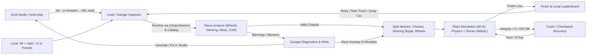
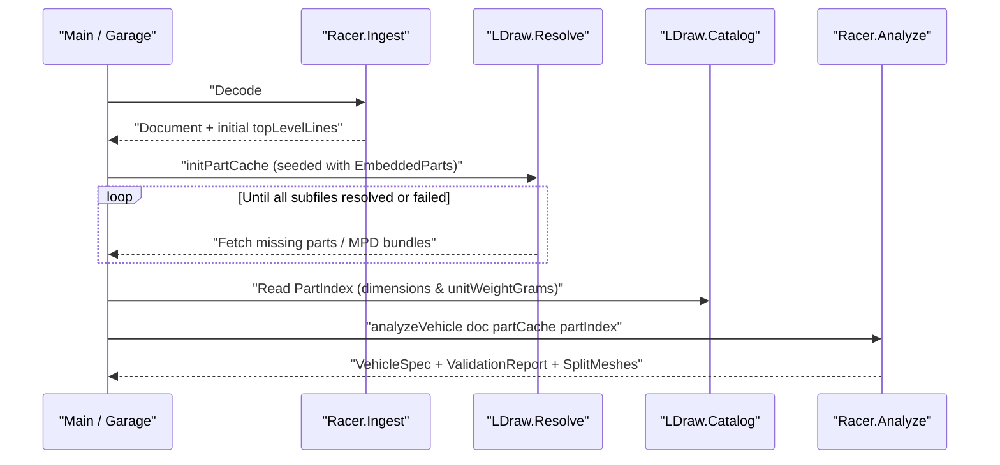
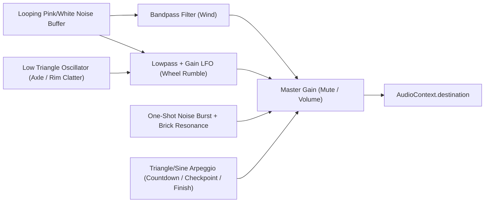
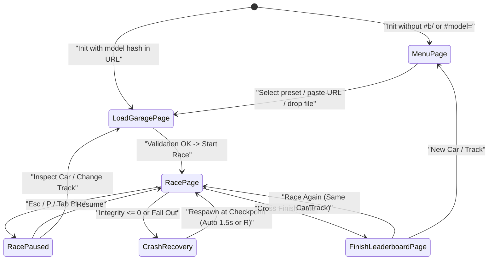

# Brick Racer (`brick-racer`) — Architecture & System Design

**Brick Racer** is a browser-based 3D gravity / soapbox racing game in the `brick-family` ecosystem (joining `brick-studio`, `brick-play`, `brick-catalog`, and the `brick-frame-*` packages). Players copy a build URL hash exported from `brick-play` or `brick-studio` (or drop an `.ldr`/`.mpd`/`.io` file or pick a starter racer), validate its rolling chassis, and steer it down procedural 3D mountain tracks under gravity.

---

## 1. Ecosystem Fit & High-Level Flow

`brick-racer` follows the sibling application template established by `brick-play/`: a standalone Elm 0.19.1 + Vite + Tailwind CSS v4 repository that vendors `brick-studio` as a submodule and compiles the shared `packages/brick-frame-*` modules directly.



### Design Principles

1. **Zero Backend Requirement:** Track generation, car validation, physics simulation, WebGL rendering, procedural Web Audio synthesis, and personal-best leaderboards run 100% client-side.
2. **True-to-Brick Mechanics:** Vehicle behavior is derived directly from the player's LDraw parts — wheel radius, wheelbase, track width, center of mass (CoM), part-count/catalog weight, frontal area, and whether the model actually includes a turntable, hinge, or ball-joint steering mechanism.
3. **Full `brick-frame` Reuse:** URL hash decoding (`Studio.HashPayload`, `Studio.UrlPayload`), LDraw asset fetching/caching (`LDraw.Resolve`, `EmbeddedParts`), part catalog weight/metadata (`LDraw.Catalog`), connection classification (`LDraw.Connectivity`), shading (`Render.Shader`, `Render.EdgeShader`), camera conventions (`Render.Camera`), and typed UI design tokens (`brick-frame-ui`, `elm-tailwind-classes`) are reused without duplicating core code.
4. **Strict TEA Purity & Tooling Compliance:** Code structure, Nix/devenv shell, `elm-format`, and `elm-review` (`LlmAgent.*` rules) match `brick-play` verbatim.

---

## 2. Repository Structure & Tech Stack

### 2.1 Directory Layout

Structured as a sibling directory `/workspace/brick-family/brick-racer` matching `brick-play`:

```text
brick-racer/
├── Makefile                    # vendor, elm-tailwind-gen, dev, build, test, check
├── devenv.nix                  # shell & ci profiles (Elm, Node 22, elm-review, treefmt)
├── devenv.yaml
├── pkgs/
│   ├── npm-tools.nix           # Nix wrapper for Vite, Tailwind v4, elm-test, fflate
│   └── package.json
├── package.json
├── elm.json                    # Elm 0.19.1 deps & shared vendor source-directories
├── vite.config.mjs             # Tailwind + elm-tailwind-classes + elm + local LDraw middleware
├── index.html
├── main.css                    # @import "tailwindcss"; + brick-frame-ui/theme.css
├── main.js                     # initBricksRuntime, Web Audio, DeviceOrientation, localStorage
├── audio.js                    # Web Audio procedural synthesizer (wind, rumble, impact, chimes)
├── vendor/
│   └── brick-studio/           # Git submodule providing brick-frame-* and master-builder
├── packages -> vendor/brick-studio/vendor/master-builder/packages
├── review/
│   ├── elm.json
│   └── src/
│       ├── ReviewConfig.elm    # Mirrors brick-play/review/src/ReviewConfig.elm
│       └── LlmAgent -> ../../vendor/brick-studio/vendor/master-builder/review/src/LlmAgent
├── public/
│   └── presets/                # Curated starter soapbox builds (.ldr/.mpd or JSON manifests)
├── src/
│   ├── Main.elm                # TEA root, Flag decode, Page state machine, Ports wiring
│   ├── Ports.elm               # Elm <-> JS ports (hash, audio, tilt sensor, storage, clipboard)
│   ├── I18n.elm                # Bilingual fi / en strings extending Brick Frame I18n pattern
│   ├── Racer/
│   │   ├── Types.elm           # Shared VehicleSpec, WheelSpec, ValidationReport, TrackId
│   │   ├── Ingest.elm          # Hash parser (#b/, #model=, #track=), preset & file loader
│   │   ├── Analyze.elm         # Wheel/axle/steering detection, mass/CoM, mesh partitioning
│   │   ├── Physics.elm         # Fixed-timestep rigid-body + 4-wheel suspension integrator
│   │   ├── Track.elm           # Seeded 3D Catmull-Rom spline, heightmap blend, obstacles
│   │   ├── TerrainMesh.elm     # Chunked WebGL terrain, track ribbon & obstacle meshes
│   │   ├── TerrainShader.elm   # Custom vertex-colored biome/fog terrain & sky dome shaders
│   │   ├── Camera.elm          # Chase, Hood/Cockpit, and Finish/Inspection Orbit camera rigs
│   │   ├── Audio.elm           # Pure derivation of continuous audio parameters from PhysicsState
│   │   ├── Leaderboard.elm     # Per-track PB splits, car class ratings, localStorage codecs
│   │   └── HUD.elm             # Speedometer, timer/splits, stability meter, mountain progress
│   └── Pages/
│       ├── Menu.elm            # Title screen, track selector, starter cars, quick URL paste
│       ├── Garage.elm          # 3D model inspection + validation checklist & telemetry readout
│       ├── Race.elm            # WebGL canvas + HUD + Pause + Crash Recovery overlay
│       └── Results.elm         # Finish screen, split table, PB delta, shareable replay link
└── tests/
    ├── IngestTest.elm
    ├── AnalyzeTest.elm
    ├── PhysicsTest.elm
    └── TrackTest.elm
```

### 2.2 Stack & Dependencies (`elm.json`, `vite.config.mjs`, `devenv.nix`)

| Layer | Technology / Package | Match with `brick-play` / `brick-studio` |
|---|---|---|
| Language & Architecture | Elm 0.19.1 (TEA) | Identical core packages (`elm/browser` 1.0.2, `elm/bytes` 1.0.8, `elm/http` 2.0.0, `elm/time` 1.0.0, `elm/url` 1.0.0) |
| Math & WebGL | `elm-explorations/linear-algebra` 1.0.3, `elm-explorations/webgl` 1.1.3 | Same `Mat4`/`Vec3` pipeline; adds custom `TerrainShader` alongside `Render.Shader` & `Render.EdgeShader` |
| Binary Hash Codecs | `danfishgold/base64-bytes` 1.1.0, `folkertdev/elm-flate` 2.0.6, `fflate` ^0.8.2 | Reuses `Studio.HashPayload`, `Studio.UrlPayload`, and `url-hash-codec.js` (`#b/<base64url>`) |
| Styling & Icons | Tailwind CSS v4 (`@tailwindcss/vite`), `elm-tailwind-classes` 0.6.1, `feathericons/elm-feather` 1.5.0 | Imports `vendor/brick-studio/packages/brick-frame-ui/theme.css`; generates typed `.elm-tailwind/` classes via `elm-tailwind-classes gen` |
| Build & Dev Server | Vite ^7.3.2 (`vite-plugin-elm` ^3.0.0) | Middleware serves `../brick-catalog/dist`, `../brick-catalog`, and `../brick-studio/viewer-app/public` in dev; dev server on port `5176` |
| Environment & CI | Nix `devenv.nix` (`shell`, `ci`), `pkgs/npm-tools.nix`, `Makefile`, `elm-review`, `treefmt` | `elm-review` uses `LlmAgent.NoTailwindRawStrings`, `LlmAgent.RequireModuleDoc`, `LlmAgent.RequireTypeAnnotation`, `LlmAgent.NoExposingEverything` |

`elm.json` `"source-directories"` includes all shared packages used by `brick-play`:
- `.elm-tailwind`
- `vendor/brick-studio/packages/brick-frame-studio/src`
- `vendor/brick-studio/packages/brick-frame-simulator/src`
- `vendor/brick-studio/packages/brick-frame-viewport/src`
- `vendor/brick-studio/packages/brick-frame-simulation/src`
- `vendor/brick-studio/packages/brick-frame-data/src`
- `vendor/brick-studio/packages/brick-frame-ui/src`
- `src`, `tests`, `packages/design-tokens/src`, `packages/ui-components/src`

### 2.3 Asset CDN & Local Fallback

Follows `brick-play/main.js` environment configuration:
- `VITE_LDRAW_BASE` defaults to `https://catalog.palikkaharrastajat.fi/raw`
- `VITE_LDRAW_INDICES_BASE` defaults to `https://catalog.palikkaharrastajat.fi/indices`
- `VITE_LDRAW_FALLBACK_BASE` defaults to `/raw`
- `initBricksRuntime` handles LDraw part/bundle fetching, part index loading (`LDraw.Catalog.partIndexDecoder`), and `.ldr`/`.mpd`/`.io` file loading.

---

## 3. Model Ingestion, Resolution & Vehicle Validation

### 3.1 Supported URL Hash & Input Formats

Players can bring a build into `brick-racer` in four ways:

1. **Direct URL Paste or Address Bar Navigation:**
   - **High-density binary hash (`brick-play` / `brick-studio`):** `#b/<base64url>` or full URL `https://.../play/#b/...` (decoded by `url-hash-codec.js` + `Studio.HashPayload.decodeBytes` — magic bytes `0x42 0x46` `"BF"`, compressed raw deflate level 9). Note: both `freePayload` (`FreeBuilding`) and `fixedModelPayload` (`Puzzle` with empty kit) decode cleanly to a `Document`.
   - **Text deep-link hash (`brick-studio` viewer):** `#model=<percent-encoded-ldr>&parts=...` (decoded via `Studio.UrlPayload.decodeHash` + `LDraw.Document.parse`).
   - **Combined Racer Deep-Link:** `#track=<trackId>&seed=<int>&b/<base64url>` or `#track=<trackId>&model=<ldr>`. `Racer.Ingest` strips `track=` and `seed=` query-like hash segments before forwarding `#b/...` or `#model=...` to `url-hash-codec.js` / `Studio.HashPayload` / `Studio.UrlPayload`.
   - **Viewport Camera Preservation (`Viewport.Hash`):** Optional `&az=...&el=...&d=...` flags are tolerated without breaking model decoding.
2. **Paste Box in Menu / Garage:** Accepts any full URL containing `#b/...` or `#model=...`, bare `b/...` fragments, or raw LDraw `.ldr`/`.mpd` text pasted directly.
3. **File Drop / Upload:** `.ldr`, `.mpd`, `.dat`, and `.io` (handled through `initBricksRuntime` file drop and `.io` zip/crypto extraction, reusing the existing `fileContentReceived` JS runtime bridge).
4. **Curated Starter Soapboxes:** Built-in builds (e.g., *Classic Pinewood Plank*, *Balloon-Tire Offroader*, *Technic Turntable Steering Kart*, *Brick-Built Trike*) stored using `EmbeddedParts` or bundled hashes so new players can race immediately without switching apps first.

### 3.2 Coordinate Systems & Scale Normalization

LDraw and `brick-frame` use three coordinate conventions that `brick-racer` bridges explicitly:

| Space | Axes | Scale | Source |
|---|---|---|---|
| **LDraw Document** | Right-handed **-Y up** (`+Y` points down) | `1 stud = 20 LDU`, `1 plate = 8 LDU`, `1 brick = 24 LDU` | `LDraw.Types` |
| **WebGL Render (`brick-frame`)** | Right-handed **+Y up** via `Mat4.makeScale3 1 -1 -1` | `1.0 unit = 1 LDU` | `Render.Scene`, `Render.Instanced` |
| **Physics World** | Right-handed **+Y up**, vehicle nose along `+Z` (normalized) | `160 LDU = 1.0 m` (`8 studs = 1.0 m`, `1 stud = 0.125 m`) | Proposed `Racer.Physics` |

**Why `160 LDU = 1.0 m` (soapbox kart scale):** Real LEGO scale (`1 LDU = 0.4 mm`) makes a 16-stud car `12.8 cm` long, where `9.81 m/s^2` gravity looks absurdly fast visually unless scaled. Scaling `160 LDU = 1.0 m` (`1 LDU = 0.00625 m`) puts a typical 14–20 stud (`280–400 LDU`) LEGO build at human-scale soapbox kart dimensions:
- A standard 14–20 stud soapbox racer is `1.75–2.50 m` long and `0.75–1.25 m` wide.
- `56891.dat` Off-Road Tire (radius `37 LDU`) has effective soapbox wheel radius `0.23 m` (~18-inch kart wheel).
- Gravity `g = 9.81 m/s^2` produces authentic 25–85 km/h downhill soapbox speeds over a `1.0–1.5 km` mountain course in ~60–110 seconds.

**Heading Normalization:** Players build cars facing arbitrary LDraw axes (`-Z`, `+Z`, `+X`, `-X`). During analysis, `Racer.Analyze` computes the car's forward axis from:
1. Front-to-rear wheel cluster vector (smaller/steerable axle cluster or steering mechanism end = front),
2. Tie-broken by steering wheel (`3829c01.dat`) / seat (`4079.dat`) facing vector or longest horizontal bounding extent.
It stores a `modelToCarTransform : Mat4` rotation (`0°, ±90°, 180°` around `+Y`) so the chassis sits centered over its CoM X/Z and points along `+Z` in physics space.

### 3.3 Asynchronous Part Resolution



Analysis runs once all referenced `.dat` dependencies reach `Loaded` or `Failed` (matching `Viewport`'s `LDraw.Resolve` completion check). Partial geometry progress shows a loading percentage bar in the Garage inspector.

### 3.4 Vehicle Decomposition & Feature Extraction (`Racer.Analyze`)

`Racer.Analyze` walks `Document` top-level placements (preserving placement IDs so moving assemblies stay grouped cleanly, while still flattening submodels recursively via `LDraw.Resolve`) and executes five extraction passes:

#### Pass 1 — Wheel & Tire Discovery
A placement is classified as a wheel component via three ordered tiers:
1. **Explicit `LDraw.Connectivity.knownCatalogPart` Table:** Inspects `ConnectionType` markers for `WheelRim { diameter }` and `WheelTire { diameter }`. Verified parts already typed or listed in `brick-frame-simulator` include:
   - Small rim/tire: `4624.dat` (Rim, r=16) + `3641.dat` (Tyre, outerR=18)
   - Medium rims/tires: `6014.dat` / `6014b.dat` (r=24) + `6015.dat` (outerR=24.8) or `56890.dat` (Balloon Tyre, outerR=30); `42610.dat` (r=20) + `50951.dat`/`50945.dat` (outerR=19)
   - Off-road rims/tires: `55981.dat` (pin hole, r=34) / `55982.dat` (axle hole, r=34) + `56891.dat` (Off-Road Tyre 37x18, outerR=37)
   - Large Technic: `56145.dat` (6-spoke, r=44) + `44309.dat` (Tyre 43x22, outerR=54)
2. **Catalog Category & Keyword Match (`LDraw.Catalog.PartInfo`):** Parts whose category/description contains `"Wheel"` or `"Tyre"` / `"Tire"` (case-insensitive) when not in `Connectivity`.
3. **Geometry Measurement:** For any catalog/non-hardcoded wheel or tire, flatten its local triangles (`LDraw.Geometry.flatten`) in Y-up render space and measure:
   - Cylindrical symmetry axis (minimum inertia / equal radial extents in 2 orthogonal axes, narrower width in the spin-axis third direction).
   - Outer tire radius `outerRadiusLdu` and tread width `treadWidthLdu`.
4. **Concentric Pairing:** Rims and tires whose world centers lie within `4 LDU` and share a parallel spin axis (`|dot(axisA, axisB)| > 0.96`) are fused into a single **`WheelAssembly`** `{ id, hubPos, spinAxis, radiusLdu, widthLdu, placementIds, gripProfile }`. Tires increase base lateral grip (`rubber` vs bare `plastic` rim if a player runs rim-only!).

#### Pass 2 — Axle Grouping & Steering Pivot Detection
1. **Axle Grouping:** `WheelAssembly` items with approximately equal longitudinal projection (`|z_i - z_j| < 24 LDU`) and collinear spin axes are grouped into front/mid/rear axle sets.
2. **Steering Mechanism Detection (using `LDraw.Connectivity` + part rules):**
   `Racer.Analyze` constructs the physical connection graph between placements (stud/anti-stud, Technic pins/axles, clips/bars, ball joints, hinges, wheel pins, turntables) and checks whether the front axle subgraph attaches to the main chassis exclusively through a pivotable steering joint:
   - **Articulated Turntable Bogie:** Front axle + wheels sit on one side of a turntable top/base (`3679.dat`/`3680.dat`, `99009.dat`/`99010.dat`, `18938.dat`) or a single vertical smooth Technic pin (`3673.dat` / `4274.dat`) aligned close to world `+Y`. Result: `SteeringMechanism.TurntableBogie { pivotPos, bogiePlacementIds }`.
   - **Knuckle / Hinge Steering:** Left and right front wheel carriers attach via hinge plates (`2429.dat`/`2430.dat`, `4275b.dat`/`4276b.dat`) or ball joints (`14417.dat`/`14418.dat`, `2736.dat`). Result: `SteeringMechanism.TwinKnuckle { leftPivot, rightPivot, leftIds, rightIds }`.
   - **Cosmetic Steering Wheel Indicator:** Detects `3829c01.dat` (Car Steering Stand and Wheel) so its wheel rotates visually in sync with steering input.
   - **Virtual Ackermann Fallback:** When wheels mount to fixed wheel-holder plates (`4600.dat`, `4488.dat`, `24326.dat`) or fixed Technic axles (`3704.dat`–`3707.dat`, `6587.dat`) directly on the rigid chassis, the car remains **fully playable** via **Soapbox Weight-Shift + Virtual Front Axle Yaw (`SteeringMechanism.FixedAxleFallback`)**: front wheels visibly yaw by up to `±22°`, but steering responsiveness is slightly softer and weight-shifting (leaning) plays a bigger role — creating an authentic gameplay incentive to build real turntable/knuckle steering in `brick-studio`!

#### Pass 3 — Mass, Center of Mass (CoM), Moment of Inertia & Aero
For every placement `p`:
- **Mass (`massGrams`):** Look up `PartInfo.unitWeightGrams` (including `LDraw.Catalog.defaultPartWeight`), falling back to `LDraw.Catalog.estimateWeightFromDimensions` using the placement's local triangle bounds (`1.05 g/cm^3` ABS × `0.45` hollow factor).
- **Center of Mass:** Mass-weighted centroid `CoM = sum(m_i * centroid_i) / sum(m_i)` converted into physics meters relative to the bottom wheel contact plane.
- **Inertia Tensor (Diagonal Approximation):** Principal yaw (`I_yy`), roll (`I_zz`), and pitch (`I_xx`) moments computed from `sum(m_i * r_perp^2)`, clamped with realistic minimums for small builds.
- **Aerodynamic Drag Area (`frontalAreaM2`):** Projected XY silhouette width × height (via `Viewport.Framing.modelBoundsFromLines` extents or grid-binned triangle projection) × shape drag estimate (`Cd ≈ 0.55–0.95` depending on wedge/slope parts vs flat vertical walls!). Builds with sloped windscreens/wedges actually cut wind slightly better!

#### Pass 4 — Validation & Garage Diagnostics Matrix
`Racer.Analyze` produces categorized findings (`Blocker`, `Warning`, `Bonus`):

| Check | Severity | Rule & Player Effect |
|---|---|---|
| Empty / Non-geometry model | `Blocker` | Zero resolved meshes -> cannot start race |
| Fewer than 3 ground-touching wheels | `Blocker` | 0–2 wheels cannot form a stable rolling soapbox stance |
| Zero wheelbase or zero track width | `Blocker` | Collinear wheels (e.g., 1D line) cannot balance -> suggests adding front/rear axle spread |
| Belly Drag / No Clearance | `Warning` | Non-wheel chassis geometry extends lower than bottom of lowest wheel tire (`chassisMinY < wheelContactY`). Playable, but adds heavy floor-scrape friction, sparks, and slower acceleration! |
| High CoM / Tippy Stance | `Warning` | `CoM.y / halfTrackWidth > 1.35` -> car is top-heavy and rolls more easily in fast hairpins |
| Floating / Disconnected Bricks | `Warning` | Graph components not connected to main chassis via `LDraw.Connectivity` -> tagged as `loosePlacements` that pop off first on bumps! |
| Rigid Fixed-Axle Steering | `Info / Tip` | No turntable/hinge pivot found -> uses Virtual Ackermann fallback; suggests adding `3679`/`3680` or `99009`/`99010` |
| Rubber Tires & Wedge Aero | `Bonus` | Shows +Grip badge for tires vs bare rims, +Aero badge for low-drag builds |

#### Pass 5 — Dynamic Sub-Assembly Mesh Partitioning
Unlike `brick-studio`'s static `Render.Scene` (which bakes the entire document at `Mat4.identity`), `brick-racer` partitions the car's placements into independent pre-baked `Render.Mesh` bundles drawn via `WebGL.entityWith` + `Render.Shader` / `Render.EdgeShader`:
1. **`chassisMesh`:** All static body bricks, rendered at `carWorldMatrix` (plus subtle suspension pitch/roll transform).
2. **`steeringBogieMesh` (if `TurntableBogie`):** Rotates around `pivotPos` by `steerAngle` inside car local space (or left/right knuckle meshes).
3. **`wheelMeshes : List { id, wheelSpec, localCenter, isSteerable, isFront, solidMesh, edgeMesh }`:** Each wheel mesh is centered around its own `localCenter` so each frame it renders at `carWorldMatrix * translate(localCenter) * steerRotY(steerAngle) * spinRotX(wheelAngle)`.
4. **`loosePartMeshes`:** Optional detachable pieces that detach cleanly if integrity drops below thresholds.

---

## 4. Physics & Downhill Simulation (`Racer.Physics`)

### 4.1 Fixed-Timestep Integrator

Browser animation frames (`Browser.Events.onAnimationFrameDelta`) vary between 30–144 Hz and stutter on tab switches. `Racer.Physics` runs a deterministic **fixed-timestep accumulator** (`fixedDt = 1.0 / 60.0` seconds, max raw frame delta clamped to `0.05 s`, max 4 physics substeps per frame):

```elm
type alias PhysicsState =
    { position : Vec3             -- Center of wheel-base ground projection (meters)
    , velocity : Vec3             -- Linear velocity in world space (m/s)
    , yaw : Float                 -- Heading angle in XZ plane (radians)
    , yawRate : Float             -- Angular velocity around world +Y (rad/s)
    , pitch : Float               -- Chassis forward tilt (rad)
    , pitchRate : Float
    , roll : Float                -- Chassis lateral roll (rad)
    , rollRate : Float
    , steerAngle : Float          -- Current smoothed front steer angle (rad)
    , leanInput : { x : Float, y : Float } -- Driver weight shift (-1..1 lateral, fore/aft)
    , wheelSpinAngles : List Float         -- Accumulated rotation angle per WheelAssembly
    , suspensionCompressions : List Float -- Previous frame compression for damping
    , groundedWheels : Int
    , airborneTime : Float
    , surfaceUnderCar : SurfaceType
    , integrity : Float           -- 100.0 -> 0.0 structural health
    , chassisScraping : Bool
    , progressS : Float           -- Closest track spline parameter s in [0, trackLength]
    , checkpointIndex : Int
    }
```

### 4.2 Forces & Dynamics Model

1. **Gravity Down Slope:**
   - World gravity $\vec{F}_g = (0, -m g, 0)$ with $g = 9.81\ \text{m/s}^2$.
   - Projected onto terrain normal $\hat{n}$ at car position: normal gravity component loads suspension; tangent component $\vec{F}_{\text{slope}} = \vec{F}_g - (\vec{F}_g \cdot \hat{n})\hat{n}$ accelerates the soapbox naturally down steeper grades without any engine/throttle!

2. **Per-Wheel Spring-Damper Suspension & Terrain Contact:**
   - Each wheel contact hub (or virtual 4-corner hull for trikes/exotic wheelbases) queries `Track.sampleAt worldX worldZ` -> `{ height, normal, surface, roadOffset }`.
   - Compression $c_i = \max(0,\ r_{\text{rest}} - (y_{\text{hub},i} - y_{\text{terrain},i}))$.
   - Vertical spring-damper force:
     $$N_i = \max\left(0,\ k_s c_i - c_d \frac{c_i - c_{i,\text{prev}}}{\Delta t}\right)$$
   - Asymmetric corner loads $(N_{\text{FL}}, N_{\text{FR}}, N_{\text{RL}}, N_{\text{RR}})$ produce pitch torque (squat/dive under braking & landing) and roll torque (body roll proportional to lateral acceleration × CoM height), plus natural airtime when cresting hills or hitting launch ramps (`c_i == 0` on all wheels).

3. **Rolling Resistance, Braking & Surface Grip:**
   - Surface coefficients vary by `SurfaceType`:
     - `AsphaltTrack`: low rolling resistance ($\mu_r = 0.015$), high tire grip ($\mu_{\text{lat}} = 1.15$).
     - `CobbleStone` / `WoodenPlank`: medium-low ($\mu_r = 0.028$, $\mu_{\text{lat}} = 0.92$) + micro-bump suspension jitter.
     - `GravelShoulder`: elevated drag ($\mu_r = 0.065$), loose driftable grip ($\mu_{\text{lat}} = 0.70$).
     - `AlpineGrass` / `SnowOffTrack`: heavy rolling drag ($\mu_r = 0.14$), low grip ($\mu_{\text{lat}} = 0.50$).
   - **Tire vs Bare Rim Multiplier:** Rubber tires yield `1.0×` grip; plastic bare-rim builds yield `0.62×` grip and louder clatter!
   - **Belly Scrape Penalty:** If validation detected negative ground clearance (`chassisMinY < wheelContactY`) or deep bottom-out compression, belly friction ($\mu_{\text{scrape}} = 0.35$) slows acceleration and shaves integrity on bumps.
   - **Brakes:** Holding `Down`/`S` applies progressive braking torque ($\text{maxDecel} \approx 6.5\ \text{m/s}^2 \cdot \text{groundedRatio}$). Holding `Space` applies rear-biased handbrake to initiate a controllable slide/drift into tight hairpins.

4. **Aerodynamic Drag:**
   - $\vec{F}_{\text{drag}} = -\frac{1}{2} \rho C_d A |\vec{v}|\vec{v}$ ($\rho = 1.225\ \text{kg/m}^3$), where $C_d A$ comes from `Racer.Analyze`.
   - **Driver Aero Tuck (`Up`/`W`):** Leaning forward reduces effective $C_d A$ by `18%` for higher terminal velocity on straights while shifting weight forward (stronger front turn-in, slightly looser rear!).

5. **Bicycle / Four-Wheel Steering & Lean Weight Shift:**
   - Max steer angle clamps smoothly with speed (`maxSteer(v) = clamp 0.14 0.52 (0.52 / (1 + 0.06 * |v|))`) to keep high-speed straights stable while letting hairpins turn sharply.
   - Lateral tire slip velocity $v_{\text{lat}}$ generates opposing lateral tire force proportional to corner load and `gripMultiplier`, inducing yaw torque $\tau_{\text{yaw}}$.
   - **Articulated Steering Bonus:** Models with a detected turntable or knuckle steering mechanism gain sharper turn-in response (`1.25×` steering authority) and tighter turning radius than `FixedAxleFallback` models.
   - **Driver Weight Shift:** Lateral lean (`steer + weightShift`) shifts CoM horizontally, transferring normal load to the inside wheels to fight rollover in fast corners — if $|\text{roll}| > 1.15\ \text{rad}$ (~66°), the soapbox tumbles, drains stability/integrity rapidly, and triggers crash recovery.

6. **Collisions & Structural Integrity ("Brick Pop-Off"):**
   - **Broadphase:** Track spline parameter `progressS` narrows obstacle checks to a ±25 m window (spatial buckets).
   - **Narrowphase:** Car bounding OBB / dual-sphere hull tested against rocks, pine tree trunks, wooden barriers, and chicane hay/brick blocks.
   - **Response:** Elastic + frictional impulse $(\vec{J}_n)$ reflects velocity along contact normal, slows car proportionally to grazing angle, plays impact sound proportional to impulse $|\vec{J}_n|$, and subtracts `integrity` above a grace threshold (`impactSpeed > 4.5 m/s`).
   - **Brick Pop-Off Debris:** Every 20% integrity lost (or on hard impact) spawns lightweight visual-only tumbling brick particles using colors sampled from the car's own bricks (or detaches tagged `loosePlacements`). At `integrity <= 0` or vertical fall below terrain kill-plane (steep cliff drop), transition to **Crash/Recovery** overlay, then reset upright to the last passed checkpoint with restored integrity and a time penalty (`+2.0 s` or clean checkpoint restart).

---

## 5. Mountain Course & Procedural Track Generation (`Racer.Track`)

### 5.1 Deterministic Spline Architecture

Each mountain track is generated deterministically from a `TrackConfig` + integer `seed` (using `elm/random` `Random.Seed` + precomputed piecewise lookup tables):

```elm
type alias ControlPoint =
    { position : Vec3     -- World center in meters (monotonically decreasing Y)
    , roadHalfWidth : Float
    , bankingRad : Float  -- Positive = banked inward into curve
    , surface : SurfaceType
    , feature : Maybe SegmentFeature
    }

type SegmentFeature
    = LaunchRamp { lengthM : Float, lipHeightM : Float }
    | Chicane { sideOffsetM : Float, barrierCount : Int }
    | RoughWash { amplitudeM : Float, wavelengthM : Float }
    | SpeedGate
```

- **Catmull-Rom 3D Spline:** Sampled at `2.0 m` arc-length intervals into a flat `Array TrackSample` (~500–800 samples for a 1.0–1.6 km downhill run). Each `TrackSample` caches `(s, center, tangent, right, normal, halfWidth, bankingRad, surface, cumElevationDrop)`.
- **Fast Spatial Queries (`Track.sampleAt x z`):** Tracks the car's local search window around `lastProgressS` (`O(1)` local Newton/segment projection onto nearby spline segments), with full-index fallback on respawn.

### 5.2 Seamless Terrain Blending & Mountain Heightmap

Instead of floating a flat ribbon in empty space, the roadbed sits carved directly into a continuous 3D mountain heightmap `h(x, z)`:

1. Find closest spline point `P(s)` with lateral signed distance $d$ from road centerline.
2. Compute road surface height including banking:
   $$y_{\text{road}}(s, d) = P_y(s) + d \cdot \tan(\phi(s)) + \text{rampOffset}(s, d)$$
3. Blend smoothly with multi-octave procedural mountain noise $y_{\text{mountain}}(x, z)$ (steep ridge walls rising outside the shoulder, gentler meadow runoff on inner sweepers):
   - $|d| \le w$: exact road surface (`w = roadHalfWidth`)
   - $w < |d| \le w + w_{\text{shoulder}}$: cubic Hermite blend (`smoothstep`) to gravel shoulder + ditch/berm
   - $|d| > w + w_{\text{shoulder}}$: blends outward into rocky cliff/alpine terrain noise (`smoothstep(w + shoulder, w + 28 m)`)
4. Analytic or finite-difference central gradient yields continuous terrain normal $\hat{n}(x, z)$ for smooth suspension physics and vertex normals.

### 5.3 Track Features, Obstacles & Checkpoints

- **Starting Ramp:** Elevated wooden/brick launch platform (`14°` initial pitch) at `s = 0` so every build accelerates smoothly from standstill on "GO!".
- **Banked Hairpins & S-Curves:** Curvature $\kappa(s)$ automatically drives recommended banking angle $\phi(s)$ (with inner apex curbing rendered in classic alternating red/white brick stripes!).
- **Ramps & Jumps:** Raised wedge segments blended cleanly into `Track.sampleAt` height; landing transitions smoothly through suspension compression.
- **Chicanes:** Staggered red/white brick chicane gates and straw/brick bales forcing technical weight-transfer slaloms.
- **Static Obstacles (`TrackObstacle`):** Pine trees, angular mountain boulders, kilometer/distance posts, wooden guardrails, and archways placed strictly outside the roadbed (or intentionally placed on off-center bonus/hazard lanes), built from low-poly geometry matching `brick-family`'s crisp faceted/LDraw edge aesthetic.
- **Checkpoints & Finish Line:** Placed every ~25% of track length (3 checkpoints + Finish Arch). Crossing a checkpoint records split time, flashes split delta (`-0.84 s`), updates respawn anchor `(s_checkpoint, pos, yaw)`, and plays a chime.

### 5.4 Course Presets & Chunked WebGL Rendering

Three flagship courses ship out of the box (plus custom `?seed=` variations):

| Preset ID | Track Name | Length / Drop | Character |
|---|---|---|---|
| `pine-ridge` | **Sunny Pine Ridge** | 1,100 m / -145 m | Wide asphalt, gentle sweeping turns, beginner-friendly jumps, high top speed |
| `quarry-switchbacks` | **Quarry Switchbacks** | 1,350 m / -210 m | Tight banked hairpins, gravel shoulders, technical chicanes, cobble sections |
| `alpine-glacier` | **Alpine Glacier Run** | 1,600 m / -285 m | Steep high-altitude drops, icy/low-grip patches, narrow ridges, dramatic cliffside bridges |

#### Chunked WebGL Architecture (`Racer.TerrainMesh`, `Racer.TerrainShader`)
- Terrain & roadbed are divided into `100 m` track-length chunks (`12–16` chunks total), built once when entering a track (`Mesh.triangles` -> `WebGL.indexedTriangles` / `WebGL.triangles`).
- **Custom `TerrainShader`:** Vertex attributes `{ position, normal, color, roadMask }` supporting:
  - Biome coloring (asphalt charcoal, alternating red/white apex curbs, gravel tan, alpine grass green, granite cliff grey, snow peaks).
  - Hemisphere sky + directional sun lighting matching `Render.Shader`'s crisp daylight look.
  - Linear/exponential atmospheric distance fog blending seamlessly into a procedural gradient sky dome so distant terrain pops in invisibly.
- **Culling:** Only chunks within `[playerChunk - 1, playerChunk + 3]` (plus `Render.Instanced.frustumFromMatrix` bounds test) are submitted to `WebGL.toHtmlWith` each frame, guaranteeing 60 FPS even alongside multi-hundred-part LEGO builds.

---

## 6. Controls, Camera Modes & Gameplay HUD

### 6.1 Input Mapping & Shortcut Guards

All keyboard handlers reuse `Viewport.Shortcuts.isTextEntryTarget` and `isWidgetKey` patterns so typing URL hashes or navigating modals never triggers race steering or resets.

| Action | Desktop Keyboard | Mobile Touch UI | Tilt / Motion Option |
|---|---|---|---|
| Steer Left / Right | `A` / `D` or `ArrowLeft` / `ArrowRight` | Large left/right `.touch-target` steer pads (or thumb slider) | `DeviceOrientationEvent.gamma` (with calibration zero & deadzone) |
| Aero Tuck / Lean Forward | `W` or `ArrowUp` | Tuck toggle / hold button | Optional forward pitch tilt |
| Brake / Lean Back | `S` or `ArrowDown` | Right-thumb Brake pedal | — |
| Handbrake / Drift Kick | `Space` | Drift pill button | — |
| Cycle Camera Mode | `C` | HUD Camera button | — |
| Respawn at Checkpoint | `R` | HUD Reset icon | — |
| Pause / Resume | `Escape` or `P` | HUD Pause button | — |

On iOS/Safari, enabling tilt steering presents an explicit user-gesture button calling `DeviceOrientationEvent.requestPermission()` via a JS port before streaming normalized `gamma` values into Elm.

### 6.2 Camera Modes (`Racer.Camera`)

`Racer.Camera` outputs a standard `Render.Camera.Camera` record (`target`, `azimuth`, `elevation`, `distance`, `projection`) so `Render.Shader`, `Render.EdgeShader`, and `Render.Instanced.frustumFromMatrix` work identically across Garage and Race scenes:

1. **Chase Cam (Default):** Follows behind the car's velocity/heading vector with spring-damped yaw lag (`1.5–4.5 m` scaled gently to car bounding radius via `Viewport.Framing.ModelBounds`, widens FOV slightly at high speed for sensation of velocity).
2. **Hood / Cockpit Cam:** Mounted slightly above `minY + 0.7 * height` looking forward over the hood, LEGO bricks, and spinning `3829c01.dat` steering wheel if present!
3. **Trackside / Free Orbit Cam:** Available during Garage inspection, Pause, and Finish podium replay (`Render.Camera.rotate`, `zoom` via mouse/touch drag).

### 6.3 Gameplay HUD (`Racer.HUD`)

Layered cleanly over the full-bleed WebGL canvas using `.elm-tailwind/` utilities and shared tokens from `brick-frame-ui/theme.css`:
- **Top-Left:** Race Timer (`01:14.32`), live Checkpoint Split badge (`-0.62 s` green / `+0.41 s` amber), current Checkpoint (`2 / 4`).
- **Top-Center:** Mountain Progress Bar showing start-to-finish percentage, remaining elevation drop (`-82 m left`), and checkpoint ticks.
- **Top-Right:** Compact icon toolbar (Camera `C`, Audio Mute, Reset `R`, Pause `Esc`).
- **Bottom-Left:** Structural Integrity / Stability Gauge (100%–0%) + live warning flashes (`Scraping!`, `Tipping!`, `Off-Track`).
- **Bottom-Right:** Digital + Arc Speedometer (`km/h`), instantaneous grade `%`, and surface grip badge (`Tarmac` / `Gravel` / `Grass` / `Airborne!`).
- **Center Transient Banners:** `3 - 2 - 1 - ROLL!`, `+AIR TIME!`, `Checkpoint Reached`, and Pause / Crash Recovery / Finish overlays.

---

## 7. Procedural Audio Engine (`audio.js` & Ports)

Rather than bundling bulky audio samples, `audio.js` builds a lightweight, zero-asset **Web Audio API** procedural sound graph unlocked on the player's first interaction (`click` / `keydown` / `touchstart`):



### Continuous Audio State (`Racer.Audio -> Port`)
Sent once per visual frame (only when running or transitioning to paused/muted, clamped via exponential smoothing in JS `setTargetAtTime`):
- `windGain`, `windFreqHz`: scales smoothly with `speed^1.6` (boosted subtly while airborne!).
- `rumbleGain`, `rumbleFreqHz`, `clatterGain`: scales with wheel speed when `groundedWheels > 0`, dropping sharply to `0` on jumps; `clatterGain` rises for `Gravel`, `CobbleStone`, or bare plastic rims; scrape sawtooth rasp activates when `chassisScraping == True`.

### Discrete Sound Events (`playSfx` Port)
- `SfxCountdownTick { isGo : Bool }`
- `SfxImpact { intensity : Float, scrape : Bool }` — plays low thud + dual pitched short brick-rattle pings proportional to collision impulse.
- `SfxLanding { intensity : Float }` — suspension bottom-out thump when returning from airborne state.
- `SfxBrickPopOff` — crisp lightweight plastic snap-clack as a debris brick tumbles off.
- `SfxCheckpoint` / `SfxFinish { newBest : Bool }` — ascending chime triad.

Mute state and master volume persist in `localStorage` (`palikkakehys.racer.audio`).

---

## 8. Elm Architecture (TEA) Breakdown

### 8.1 Page & Game State Machine



### 8.2 Core Types (`src/Main.elm`, `src/Racer/Types.elm`)

```elm
type alias Flags =
    { initialHash : String
    , ldrawBase : String
    , indicesBase : String
    , ldrawFallbackBase : String
    , coarsePointer : Bool
    , language : String
    , savedAudioMuted : Bool
    , savedLeaderboardJson : String
    , baseUrl : String
    }

type alias Model =
    { runtimeConfig : Resolve.Config
    , partCache : PartCache
    , partIndex : PartIndex
    , activeTrack : TrackConfig
    , trackData : Maybe GeneratedTrack
    , language : I18n.Language
    , viewportSize : { width : Int, height : Int }
    , coarsePointer : Bool
    , audioMuted : Bool
    , leaderboard : Leaderboard
    , page : Page
    }

type Page
    = MenuPage MenuState
    | LoadGaragePage GarageState      -- Loading parts + Validation + 3D Orbit Preview
    | RacePage RaceState              -- Countdown / Racing / Paused / CrashRecovery
    | FinishLeaderboardPage FinishState
```

Inside `RaceState`:

```elm
type RacePhase
    = Countdown Float                 -- 3.0 -> 0.0 seconds
    | Racing
    | Paused
    | CrashRecovery { timer : Float, reason : CrashReason }

type alias RaceState =
    { vehicle : VehicleSpec
    , carMeshes : CarMeshBundle       -- chassis, steeringBogie, per-wheel meshes
    , physics : PhysicsState
    , phase : RacePhase
    , elapsedTime : Float
    , accumulator : Float             -- Fixed-timestep remainder
    , input : InputState              -- Pressed keys + touch + tilt
    , cameraMode : CameraMode         -- Chase | Hood | Orbit
    , camera : Camera
    , particles : List BrickDebris    -- Pop-off bricks & dust puffs
    , splitTimes : List Float
    , hudAlert : Maybe HudAlert
    }
```

### 8.3 `Msg`, `update`, and Sub-Module Boundaries

Root `Msg` routes page actions cleanly (following `brick-studio`'s "pages emit intents/events rather than holding ports directly" pattern):

```elm
type Msg
    = WindowResized Int Int
    | VisibilityChanged Browser.Events.Visibility
    | KeyChanged Bool Shortcuts.KeyEvent
    | AnimationFrameDelta Float
    | MenuMsg Menu.Msg
    | GarageMsg Garage.Msg
    | RaceMsg Race.Msg
    | ResultsMsg Results.Msg
    | RuntimeResolveMsg Resolve.Msg     -- Part bundle & index HTTP completions
    | FileContentReceived String        -- Parsed LDraw / .io content via initBricksRuntime
    | HashChanged String              -- Browser hashchange listener
    | TiltOrientationReceived { available : Bool, gamma : Float, beta : Float }
    | ToggleAudioMute
    | SetLanguage I18n.Language
```

**Update flow during `Racing`:**
1. Clamp frame `dt` (`min 0.05 (deltaMs / 1000)`), add to `accumulator`.
2. Loop fixed substeps (`fixedDt = 1 / 60`):
   - `Physics.step fixedDt trackData vehicle input physics` -> `( nextPhysics, events )`.
   - Handle `events`: `Impact { impulse, scrape }`, `Landing impulse`, `CheckpointCrossed idx`, `BrickDetached`, `Crashed reason`, `FinishedRace`.
3. Update `BrickDebris` ballistic particles (1.5 s lifetime), `Camera.update`, and HUD split banners.
4. Emit `Ports.updateAudioState` and any triggered `Ports.playSfx` commands.
5. On `FinishedRace`, compare against `Leaderboard`, persist updated PB via `Ports.saveLeaderboard`, play finish chime, and transition to `FinishLeaderboardPage`.

### 8.4 Subscriptions

- `Browser.Events.onResize WindowResized`
- `Browser.Events.onVisibilityChange VisibilityChanged` (auto-pauses `RacePage` when switching browser tabs)
- `Browser.Events.onKeyDown` / `onKeyUp` (decodes DOM `event.target` into `Viewport.Shortcuts.KeyEvent` and filters via `isTextEntryTarget` so text inputs in Menu/Garage work normally)
- `Browser.Events.onAnimationFrameDelta AnimationFrameDelta` (active during `RacePage` except `Paused`, during `LoadGaragePage` slow turntable orbit/loading, or particle settle)
- Ports: `hashChanged`, `fileContentReceived`, `tiltOrientationReceived`

### 8.5 Ports Contract (`src/Ports.elm` <-> `main.js`)

| Port | Direction | Payload | Purpose |
|---|---|---|---|
| `decodeBinaryHash` / `binaryHashDecoded` | Elm <-> JS | `String` <-> `Maybe (List Int)` (or decode in JS on init & hashchange via `url-hash-codec.js`) | Inflate `#b/<base64url>` payloads pasted in-app without page reload |
| `setUrlHash` | Elm -> JS | `String` | Update `#track=<id>&b/...` share link without full navigation |
| `copyShareUrl` | Elm -> JS | `String` | Copy shareable race URL (`#track=...&b/...`) to clipboard |
| `updateAudioState` | Elm -> JS | `{ active : Bool, windGain : Float, windHz : Float, rumbleGain : Float, rumbleHz : Float, clatterGain : Float, scrapeGain : Float }` | Drive smooth continuous Web Audio synthesis |
| `playSfx` | Elm -> JS | `{ kind : String, intensity : Float }` | Trigger impact, landing, brick-pop, countdown, checkpoint, finish sounds |
| `setAudioMuted` | Elm -> JS | `Bool` | Mute/unmute and persist in `localStorage` |
| `requestTiltPermission` / `tiltOrientationReceived` | Elm <-> JS | `()` / `{ available : Bool, gamma : Float, beta : Float }` | iOS permission prompt & live accelerometer tilt-to-steer |
| `saveLeaderboard` | Elm -> JS | `String` | Save JSON personal bests & recent runs to `localStorage` |
| `storeLanguage` | Elm -> JS | `String` | Persist `"fi"` / `"en"` matching `brick-play` (`palikkakehys.language`) |

### 8.6 View Layer Composition

- **Menu / Garage Inspector:** Two-column responsive layout (mobile stacks canvas above compact validation/launch sheet), reusing `Viewport` (or `Racer.Camera` + `WebGL.toHtmlWith`) to display the car rotating over a miniature starting plinth, overlaid with clear wheel/steering/CoM telemetry badges and a green **"Drop Down Mountain!"** CTA.
- **Race View:** Full-viewport `<canvas>` rendered by `WebGL.toHtmlWith` (`alpha False`, `depth 1`, `antialias`, dynamic device-pixel ratio scaling / adaptive quality option if FPS dips), compositing:
  1. Procedural sky dome (`TerrainShader.skyEntity`)
  2. Visible terrain/track chunks + ramps/checkpoints/obstacles (`TerrainShader.terrainEntity`)
  3. Dynamic car sub-assemblies (`chassis`, `steeringBogie`, spinning `wheels`) shaded with `Render.Shader` & `Render.EdgeShader` + ground drop-shadow blob/quad under car!
  4. Tumbling `BrickDebris` pieces
  5. Pointer-events-none Tailwind HUD layer + touch control buttons at bottom corners when `coarsePointer == True` or touch toggle enabled.

---

## 9. Cross-App Integration, Verification & Milestones

### 9.1 Linking from `brick-studio` and `brick-play`

Add an optional `"Race in Brick Racer"` action alongside `"Simulate"` / `"Share"` in `brick-play` (`src/Link.elm` / share modal) and `brick-studio`:
- When `VITE_RACER_URL` (or relative sibling `../racer/`) is configured, emit `<racerBase>#track=pine-ridge&b/<base64url>` from `Link.freeHash` or `Link.fixedModelHash` (using `encodeHash`), letting builders test their soapbox creations down the mountain in one click.

### 9.2 Verification Strategy (`elm-test`, `elm-review`, Browser Tests)

1. **`elm-test` Unit Suites (`make test`):**
   - `IngestTest`: verifies `#b/<base64url>`, `#model=...`, `#track=...&b/...`, and bare pasted URLs decode into valid `Document` + `TrackId`.
   - `AnalyzeTest`: tests fixture builds (4-wheel fixed holder `4600.dat`, turntable steering bogie `3679.dat`/`3680.dat`, bare-rim vs rubber-tire selection, zero-clearance warning, 2-wheel blocker, disconnected brick detection, heading normalization).
   - `PhysicsTest`: conservation & invariants (zero slope + zero speed stays stationary; steeper slope increases terminal speed; belly-scrape applies extra drag; braking decelerates smoothly; airborne flag clears ground rumble; checkpoint recovery resets upright).
   - `TrackTest`: spline monotonicity (every track monotonically drops overall and stays finite/smooth), roadbed terrain blend continuity across shoulder boundary, deterministic replay from equal `seed`.
2. **Static Checks (`make check`):**
   - `elm-format --validate src/ tests/`
   - `elm-review` enforcing `NoTailwindRawStrings`, `RequireModuleDoc`, `RequireTypeAnnotation`, `NoExposingEverything`.
3. **Browser Acceptance Smoke Test:**
   - Launch starter build via URL hash, assert Garage reaches `Ready` with 4 detected wheels, enter Race, assert canvas draws non-blank frames and distance `progressS` advances down the mountain under steering inputs without console/WebGL errors.

### 9.3 Suggested Implementation Milestones

| Phase | Scope | Exit Criteria |
|---|---|---|
| **M1 — Scaffold & Ingest** | Repo setup (`devenv.nix`, `elm.json`, `Makefile`, `vite.config.mjs`), `#b/` & `#model=` parser, `LDraw.Resolve` preview in Garage | Can paste any `brick-play` / `brick-studio` URL hash and inspect the car in 3D |
| **M2 — Vehicle Analyzer** | `Racer.Analyze` wheel/tire pairing, turntable/knuckle detection, mass/CoM calculation, validation checklist, mesh splitting | Garage displays accurate wheel count, steering type, CoM/weight, and spins front wheels cleanly |
| **M3 — Track & Terrain Renderer** | `Racer.Track` Catmull-Rom spline + heightmap blend + chunked `TerrainMesh` + `TerrainShader` + Pine Ridge preset | Full 3D mountain course renders at 60 FPS with fog, banking, ramps, checkpoints |
| **M4 — Physics & Gameplay Loop** | `Racer.Physics` fixed-step suspension, grip, aero, obstacles, crash/recovery, Chase/Hood cams, full HUD, `Results` local PBs | Complete playable downhill race loop from Start Ramp to Finish Arch |
| **M5 — Audio, Mobile & Polish** | `audio.js` Web Audio synth, touch controls + tilt port, Quarry & Alpine tracks, brick pop-off debris, `brick-play`/`brick-studio` export link, full test suite | `make check` and `make test` green; responsive desktop + mobile playtest verified |
