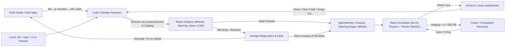
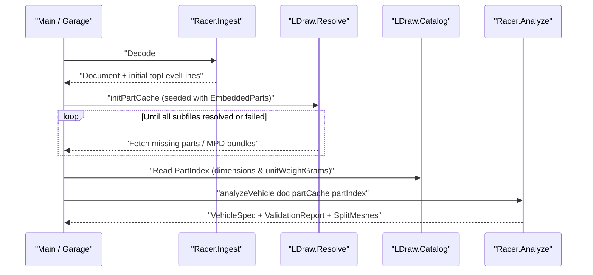
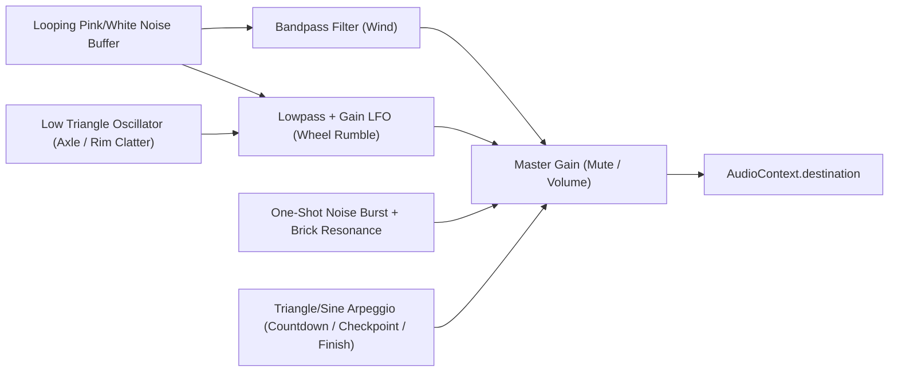
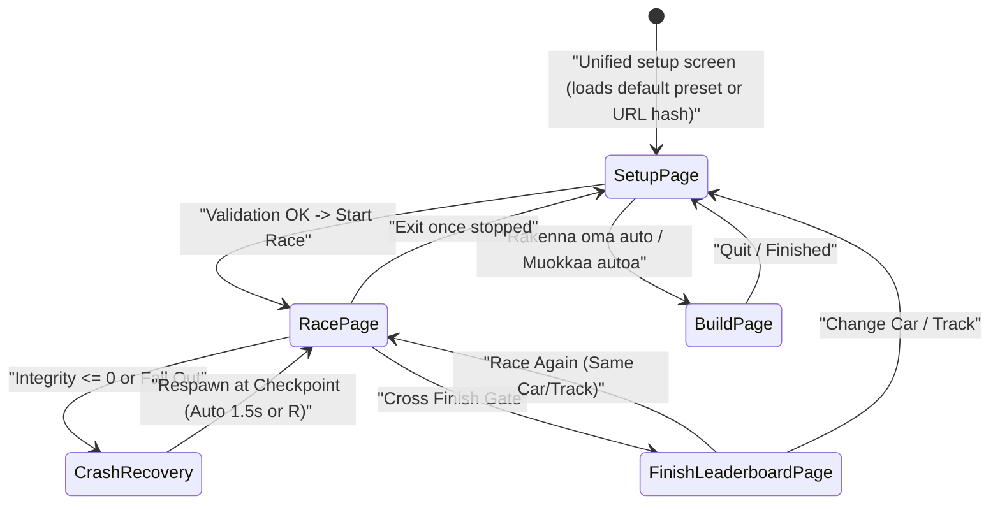

# Brick Racer (`brick-racer`) — Architecture & System Design

**Brick Racer** is a browser-based 3D gravity / soapbox racing game in the `brick-family` ecosystem (joining `brick-studio`, `brick-play`, `brick-catalog`, and the `brick-frame-*` packages). Players copy a build URL hash exported from `brick-play` or `brick-studio` (or drop an `.ldr`/`.mpd`/`.io` file or pick a starter racer), validate its rolling chassis, and steer it down short, steep procedural countryside tracks under gravity, smashing brick-built roadside scenery on the way.

---

## 1. Ecosystem Fit & High-Level Flow

`brick-racer` follows the sibling application template established by `brick-play/`: a standalone Elm 0.19.1 + Vite + Tailwind CSS v4 repository that vendors `brick-studio` as a submodule and compiles the shared `packages/brick-frame-*` modules directly.



### Design Principles

1. **Zero Backend Requirement:** Track generation, car validation, physics simulation, WebGL rendering, procedural Web Audio synthesis, and personal-best leaderboards run 100% client-side.
2. **True-to-Brick Mechanics:** Vehicle behavior is derived directly from the player's LDraw parts — wheel radius, wheelbase, track width, center of mass (CoM), part-count/catalog weight, frontal area, and whether the model actually includes a turntable, hinge, or ball-joint steering mechanism.
3. **Full `brick-frame` Reuse:** URL hash decoding (`Studio.HashPayload`, `Studio.UrlPayload`), LDraw asset fetching/caching (`LDraw.Resolve`, `EmbeddedParts`), part catalog weight/metadata (`LDraw.Catalog`), connection classification (`LDraw.Connectivity`), shading (`Render.Shader`, `Render.EdgeShader`), camera conventions (`Render.Camera`), and typed UI design tokens (`brick-frame-ui`, `elm-tailwind-classes`) are reused without duplicating core code.
4. **Strict TEA Purity & Tooling Compliance:** Code structure, Nix/devenv shell, `elm-format`, and `elm-review` (`LlmAgent.*` rules) match `brick-play` verbatim.

---

## 2. Repository Structure & Tech Stack

### 2.1 Directory Layout

Structured as a sibling directory `/workspace/brick-family/brick-racer` matching `brick-play`:

```text
brick-racer/
├── Makefile                    # vendor, elm-tailwind-gen, dev, build, test, check
├── devenv.nix                  # shell & ci profiles (Elm, Node 22, elm-review, treefmt)
├── devenv.yaml
├── pkgs/
│   ├── npm-tools.nix           # Nix wrapper for Vite, Tailwind v4, elm-test, fflate
│   └── package.json
├── package.json
├── elm.json                    # Elm 0.19.1 deps & shared vendor source-directories
├── vite.config.mjs             # Tailwind + elm-tailwind-classes + elm + local LDraw middleware
├── index.html
├── main.css                    # @import "tailwindcss"; + brick-frame-ui/theme.css
├── main.js                     # initBricksRuntime, Web Audio, DeviceOrientation, localStorage
├── audio.js                    # Web Audio procedural synthesizer (wind, rumble, impact, chimes)
├── vendor/
│   └── brick-studio/           # Git submodule providing brick-frame-* and master-builder
├── packages -> vendor/brick-studio/vendor/master-builder/packages
├── review/
│   ├── elm.json
│   └── src/
│       ├── ReviewConfig.elm    # Mirrors brick-play/review/src/ReviewConfig.elm
│       └── LlmAgent -> ../../vendor/brick-studio/vendor/master-builder/review/src/LlmAgent
├── public/
│   └── presets/                # Curated starter soapbox builds (.ldr/.mpd or JSON manifests)
├── src/
│   ├── Main.elm                # TEA root, Flag decode, Page state machine, Ports wiring
│   ├── Ports.elm               # Elm <-> JS ports (hash, audio, tilt sensor, storage, clipboard)
│   ├── I18n.elm                # Bilingual fi / en strings extending Brick Frame I18n pattern
│   ├── Racer/
│   │   ├── Types.elm           # Shared VehicleSpec, WheelSpec, ValidationReport, TrackId
│   │   ├── Ingest.elm          # Hash parser (#b/, #model=, #track=), preset & file loader
│   │   ├── Analyze.elm         # Wheel/axle/steering detection, mass/CoM, mesh partitioning
│   │   ├── Physics.elm         # Fixed-timestep rigid-body + 4-wheel suspension integrator
│   │   ├── Track.elm           # Seeded 3D Catmull-Rom spline, heightmap blend, obstacles
│   │   ├── TerrainMesh.elm     # Chunked WebGL terrain, track ribbon & obstacle meshes
│   │   ├── TerrainShader.elm   # Custom vertex-colored biome/fog terrain & sky dome shaders
│   │   ├── Camera.elm          # Chase and Finish/Inspection Orbit camera rigs
│   │   ├── Audio.elm           # Pure derivation of continuous audio parameters from PhysicsState
│   │   ├── Leaderboard.elm     # Per-track PB splits, car class ratings, localStorage codecs
│   │   └── HUD.elm             # Speedometer, timer/splits, stability meter, course progress
│   └── Pages/
│       ├── Menu.elm            # Title screen, track selector, starter cars, quick URL paste
│       ├── Garage.elm          # 3D model inspection + validation checklist & telemetry readout
│       ├── Race.elm            # WebGL canvas + HUD + Pause + Crash Recovery overlay
│       └── Results.elm         # Finish screen, split table, PB delta, shareable replay link
└── tests/
    ├── IngestTest.elm
    ├── AnalyzeTest.elm
    ├── PhysicsTest.elm
    └── TrackTest.elm
```

### 2.2 Stack & Dependencies (`elm.json`, `vite.config.mjs`, `devenv.nix`)

| Layer | Technology / Package | Match with `brick-play` / `brick-studio` |
|---|---|---|
| Language & Architecture | Elm 0.19.1 (TEA) | Identical core packages (`elm/browser` 1.0.2, `elm/bytes` 1.0.8, `elm/http` 2.0.0, `elm/time` 1.0.0, `elm/url` 1.0.0) |
| Math & WebGL | `elm-explorations/linear-algebra` 1.0.3, `elm-explorations/webgl` 1.1.3 | Same `Mat4`/`Vec3` pipeline; adds custom `TerrainShader` alongside `Render.Shader` & `Render.EdgeShader` |
| Binary Hash Codecs | `danfishgold/base64-bytes` 1.1.0, `folkertdev/elm-flate` 2.0.6, `fflate` ^0.8.2 | Reuses `Studio.HashPayload`, `Studio.UrlPayload`, and `url-hash-codec.js` (`#b/<base64url>`) |
| Styling & Icons | Tailwind CSS v4 (`@tailwindcss/vite`), `elm-tailwind-classes` 0.6.1, `feathericons/elm-feather` 1.5.0 | Imports `vendor/brick-studio/packages/brick-frame-ui/theme.css`; generates typed `.elm-tailwind/` classes via `elm-tailwind-classes gen` |
| Build & Dev Server | Vite ^7.3.2 (`vite-plugin-elm` ^3.0.0) | Middleware serves `../brick-catalog/dist`, `../brick-catalog`, and `../brick-studio/viewer-app/public` in dev; dev server on port `5176` |
| Environment & CI | Nix `devenv.nix` (`shell`, `ci`), `pkgs/npm-tools.nix`, `Makefile`, `elm-review`, `treefmt` | `elm-review` uses `LlmAgent.NoTailwindRawStrings`, `LlmAgent.RequireModuleDoc`, `LlmAgent.RequireTypeAnnotation`, `LlmAgent.NoExposingEverything` |

`elm.json` `"source-directories"` includes all shared packages used by `brick-play`:
- `.elm-tailwind`
- `vendor/brick-studio/packages/brick-frame-studio/src`
- `vendor/brick-studio/packages/brick-frame-simulator/src`
- `vendor/brick-studio/packages/brick-frame-viewport/src`
- `vendor/brick-studio/packages/brick-frame-simulation/src`
- `vendor/brick-studio/packages/brick-frame-data/src`
- `vendor/brick-studio/packages/brick-frame-ui/src`
- `src`, `tests`, `packages/design-tokens/src`, `packages/ui-components/src`

### 2.3 Asset CDN & Local Fallback

Follows `brick-play/main.js` environment configuration:
- `VITE_LDRAW_BASE` defaults to `https://catalog.palikkaharrastajat.fi/raw`
- `VITE_LDRAW_INDICES_BASE` defaults to `https://catalog.palikkaharrastajat.fi/indices`
- `VITE_LDRAW_FALLBACK_BASE` defaults to `/raw`
- `initBricksRuntime` handles LDraw part/bundle fetching, part index loading (`LDraw.Catalog.partIndexDecoder`), and `.ldr`/`.mpd`/`.io` file loading.

---

## 3. Model Ingestion, Resolution & Vehicle Validation

### 3.1 Supported URL Hash & Input Formats

Players can bring a build into `brick-racer` in four ways:

1. **Direct URL Paste or Address Bar Navigation:**
   - **High-density binary hash (`brick-play` / `brick-studio`):** `#b/<base64url>` or full URL `https://.../play/#b/...` (decoded by `url-hash-codec.js` + `Studio.HashPayload.decodeBytes` — magic bytes `0x42 0x46` `"BF"`, compressed raw deflate level 9). Note: both `freePayload` (`FreeBuilding`) and `fixedModelPayload` (`Puzzle` with empty kit) decode cleanly to a `Document`.
   - **Text deep-link hash (`brick-studio` viewer):** `#model=<percent-encoded-ldr>&parts=...` (decoded via `Studio.UrlPayload.decodeHash` + `LDraw.Document.parse`).
   - **Combined Racer Deep-Link:** `#track=<trackId>&seed=<int>&b/<base64url>` or `#track=<trackId>&model=<ldr>`. `Racer.Ingest` strips `track=` and `seed=` query-like hash segments before forwarding `#b/...` or `#model=...` to `url-hash-codec.js` / `Studio.HashPayload` / `Studio.UrlPayload`.
   - **Viewport Camera Preservation (`Viewport.Hash`):** Optional `&az=...&el=...&d=...` flags are tolerated without breaking model decoding.
2. **Paste Box in Menu / Garage:** Accepts any full URL containing `#b/...` or `#model=...`, bare `b/...` fragments, or raw LDraw `.ldr`/`.mpd` text pasted directly.
3. **File Drop / Upload:** `.ldr`, `.mpd`, `.dat`, and `.io` (handled through `initBricksRuntime` file drop and `.io` zip/crypto extraction, reusing the existing `fileContentReceived` JS runtime bridge).
4. **Curated Starter Soapboxes:** Built-in builds (e.g., *Classic Pinewood Plank*, *Balloon-Tire Offroader*, *Turntable Steering Kart*, *Brick-Built Trike*) stored using `EmbeddedParts` or bundled hashes so new players can race immediately without switching apps first.

### 3.2 Coordinate Systems & Scale Normalization

LDraw and `brick-frame` use three coordinate conventions that `brick-racer` bridges explicitly:

| Space | Axes | Scale | Source |
|---|---|---|---|
| **LDraw Document** | Right-handed **-Y up** (`+Y` points down) | `1 stud = 20 LDU`, `1 plate = 8 LDU`, `1 brick = 24 LDU` | `LDraw.Types` |
| **WebGL Render (`brick-frame`)** | Right-handed **+Y up** via `Mat4.makeScale3 1 -1 -1` | `1.0 unit = 1 LDU` | `Render.Scene`, `Render.Instanced` |
| **Physics World** | Right-handed **+Y up**, vehicle nose along `+Z` (normalized) | `160 LDU = 1.0 m` (`8 studs = 1.0 m`, `1 stud = 0.125 m`) | Proposed `Racer.Physics` |

**Why `160 LDU = 1.0 m` (soapbox kart scale):** Real brick scale (`1 LDU = 0.4 mm`) makes a 16-stud car `12.8 cm` long, where `9.81 m/s^2` gravity looks absurdly fast visually unless scaled. Scaling `160 LDU = 1.0 m` (`1 LDU = 0.00625 m`) puts a typical 14–20 stud (`280–400 LDU`) brick build at human-scale soapbox kart dimensions:
- A standard 14–20 stud soapbox racer is `1.75–2.50 m` long and `0.75–1.25 m` wide.
- `56891.dat` Off-Road Tire (radius `37 LDU`) has effective soapbox wheel radius `0.23 m` (~18-inch kart wheel).
- Gravity `g = 9.81 m/s^2` produces authentic 25–85 km/h downhill soapbox speeds over a `0.45–0.56 km` countryside course in roughly 30–60 seconds.

**Heading Normalization:** Players build cars facing arbitrary LDraw axes (`-Z`, `+Z`, `+X`, `-X`). During analysis, `Racer.Analyze` computes the car's forward axis from:
1. Front-to-rear wheel cluster vector (smaller/steerable axle cluster or steering mechanism end = front),
2. Tie-broken by steering wheel (`3829c01.dat`) / seat (`4079.dat`) facing vector or longest horizontal bounding extent.
It stores a `modelToCarTransform : Mat4` rotation (`0°, ±90°, 180°` around `+Y`) so the chassis sits centered over its CoM X/Z and points along `+Z` in physics space.

### 3.3 Asynchronous Part Resolution



Analysis runs once all referenced `.dat` dependencies reach `Loaded` or `Failed` (matching `Viewport`'s `LDraw.Resolve` completion check). Partial geometry progress shows a loading percentage bar in the Garage inspector.

### 3.4 Vehicle Decomposition & Feature Extraction (`Racer.Analyze`)

`Racer.Analyze` walks `Document` top-level placements (preserving placement IDs so moving assemblies stay grouped cleanly, while still flattening submodels recursively via `LDraw.Resolve`) and executes five extraction passes:

#### Pass 1 — Wheel & Tire Discovery
A placement is classified as a wheel component via three ordered tiers:
1. **Explicit `LDraw.Connectivity.knownCatalogPart` Table:** Inspects `ConnectionType` markers for `WheelRim { diameter }` and `WheelTire { diameter }`. Verified parts already typed or listed in `brick-frame-simulator` include:
   - Small rim/tire: `4624.dat` (Rim, r=16) + `3641.dat` (Tyre, outerR=18)
   - Medium rims/tires: `6014.dat` / `6014b.dat` (r=24) + `6015.dat` (outerR=24.8) or `56890.dat` (Balloon Tyre, outerR=30); `42610.dat` (r=20) + `50951.dat`/`50945.dat` (outerR=19)
   - Off-road rims/tires: `55981.dat` (pin hole, r=34) / `55982.dat` (axle hole, r=34) + `56891.dat` (Off-Road Tyre 37x18, outerR=37)
   - Large pin-and-axle wheel: `56145.dat` (6-spoke, r=44) + `44309.dat` (Tyre 43x22, outerR=54)
2. **Catalog Category & Keyword Match (`LDraw.Catalog.PartInfo`):** Parts whose category/description contains `"Wheel"` or `"Tyre"` / `"Tire"` (case-insensitive) when not in `Connectivity`.
3. **Geometry Measurement:** For any catalog/non-hardcoded wheel or tire, flatten its local triangles (`LDraw.Geometry.flatten`) in Y-up render space and measure:
   - Cylindrical symmetry axis (minimum inertia / equal radial extents in 2 orthogonal axes, narrower width in the spin-axis third direction).
   - Outer tire radius `outerRadiusLdu` and tread width `treadWidthLdu`.
4. **Concentric Pairing:** Rims and tires whose world centers lie within `4 LDU` and share a parallel spin axis (`|dot(axisA, axisB)| > 0.96`) are fused into a single **`WheelAssembly`** `{ id, hubPos, spinAxis, radiusLdu, widthLdu, placementIds, gripProfile }`. Tires increase base lateral grip (`rubber` vs bare `plastic` rim if a player runs rim-only!).

#### Pass 2 — Axle Grouping & Steering Pivot Detection
1. **Axle Grouping:** `WheelAssembly` items with approximately equal longitudinal projection (`|z_i - z_j| < 24 LDU`) and collinear spin axes are grouped into front/mid/rear axle sets.
2. **Steering Mechanism Detection (using `LDraw.Connectivity` + part rules):**
   `Racer.Analyze` constructs the physical connection graph between placements (stud/anti-stud, pins/axles, clips/bars, ball joints, hinges, wheel pins, turntables) and checks whether the front axle subgraph attaches to the main chassis exclusively through a pivotable steering joint:
   - **Articulated Turntable Bogie:** Front axle + wheels sit on one side of a turntable top/base (`3679.dat`/`3680.dat`, `99009.dat`/`99010.dat`, `18938.dat`) or a single vertical smooth pin (`3673.dat` / `4274.dat`) aligned close to world `+Y`. Result: `SteeringMechanism.TurntableBogie { pivotPos, bogiePlacementIds }`.
   - **Knuckle / Hinge Steering:** Left and right front wheel carriers attach via hinge plates (`2429.dat`/`2430.dat`, `4275b.dat`/`4276b.dat`) or ball joints (`14417.dat`/`14418.dat`, `2736.dat`). Result: `SteeringMechanism.TwinKnuckle { leftPivot, rightPivot, leftIds, rightIds }`.
   - **Cosmetic Steering Wheel Indicator:** Detects `3829c01.dat` (Car Steering Stand and Wheel) so its wheel rotates visually in sync with steering input.
   - **Virtual Ackermann Fallback:** When wheels mount to fixed wheel-holder plates (`4600.dat`, `4488.dat`, `24326.dat`) or fixed axles (`3704.dat`–`3707.dat`, `6587.dat`) directly on the rigid chassis, the car remains **fully playable** via **Soapbox Weight-Shift + Virtual Front Axle Yaw (`SteeringMechanism.FixedAxleFallback`)**: front wheels visibly yaw by up to `±22°`, but steering responsiveness is slightly softer and weight-shifting (leaning) plays a bigger role — creating an authentic gameplay incentive to build real turntable/knuckle steering in `brick-studio`!

#### Pass 3 — Mass, Center of Mass (CoM), Moment of Inertia & Aero
For every placement `p`:
- **Mass (`massGrams`):** Look up `PartInfo.unitWeightGrams` (including `LDraw.Catalog.defaultPartWeight`), falling back to `LDraw.Catalog.estimateWeightFromDimensions` using the placement's local triangle bounds (`1.05 g/cm^3` ABS × `0.45` hollow factor).
- **Center of Mass:** Mass-weighted centroid `CoM = sum(m_i * centroid_i) / sum(m_i)` converted into physics meters relative to the bottom wheel contact plane.
- **Inertia Tensor (Diagonal Approximation):** Principal yaw (`I_yy`), roll (`I_zz`), and pitch (`I_xx`) moments computed from `sum(m_i * r_perp^2)`, clamped with realistic minimums for small builds.
- **Aerodynamic Drag Area (`frontalAreaM2`):** Projected XY silhouette width × height (via `Viewport.Framing.modelBoundsFromLines` extents or grid-binned triangle projection) × shape drag estimate (`Cd ≈ 0.55–0.95` depending on wedge/slope parts vs flat vertical walls!). Builds with sloped windscreens/wedges actually cut wind slightly better!

#### Pass 4 — Validation & Garage Diagnostics Matrix
`Racer.Analyze` produces categorized findings (`Blocker`, `Warning`, `Bonus`):

| Check | Severity | Rule & Player Effect |
|---|---|---|
| Empty / Non-geometry model | `Blocker` | Zero resolved meshes -> cannot start race |
| Fewer than 3 ground-touching wheels | `Blocker` | 0–2 wheels cannot form a stable rolling soapbox stance |
| Zero wheelbase or zero track width | `Blocker` | Collinear wheels (e.g., 1D line) cannot balance -> suggests adding front/rear axle spread |
| Belly Drag / No Clearance | `Warning` | Non-wheel chassis geometry extends lower than bottom of lowest wheel tire (`chassisMinY < wheelContactY`). Playable, but adds heavy floor-scrape friction, sparks, and slower acceleration! |
| High CoM / Tippy Stance | `Warning` | `CoM.y / halfTrackWidth > 1.35` -> car is top-heavy and rolls more easily in fast hairpins |
| Floating / Disconnected Bricks | `Warning` | Graph components not connected to main chassis via `LDraw.Connectivity` -> tagged as `loosePlacements` that pop off first on bumps! |
| Rigid Fixed-Axle Steering | `Info / Tip` | No turntable/hinge pivot found -> uses Virtual Ackermann fallback; suggests adding `3679`/`3680` or `99009`/`99010` |
| Rubber Tires & Wedge Aero | `Bonus` | Shows +Grip badge for tires vs bare rims, +Aero badge for low-drag builds |

#### Pass 5 — Dynamic Sub-Assembly Mesh Partitioning
Unlike `brick-studio`'s static `Render.Scene` (which bakes the entire document at `Mat4.identity`), `brick-racer` partitions the car's placements into independent pre-baked `Render.Mesh` bundles drawn via `WebGL.entityWith` + `Render.Shader` / `Render.EdgeShader`:
1. **`chassisMesh`:** All static body bricks, rendered at `carWorldMatrix` (plus subtle suspension pitch/roll transform).
2. **`steeringBogieMesh` (if `TurntableBogie`):** Rotates around `pivotPos` by `steerAngle` inside car local space (or left/right knuckle meshes).
3. **`wheelMeshes : List { id, wheelSpec, localCenter, isSteerable, isFront, solidMesh, edgeMesh }`:** Each wheel mesh is centered around its own `localCenter` so each frame it renders at `carWorldMatrix * translate(localCenter) * steerRotY(steerAngle) * spinRotX(wheelAngle)`.
4. **`loosePartMeshes`:** Optional detachable pieces that detach cleanly if integrity drops below thresholds.

---

## 4. Physics & Downhill Simulation (`Racer.Physics`)

### 4.1 Fixed-Timestep Integrator

Browser animation frames (`Browser.Events.onAnimationFrameDelta`) vary between 30–144 Hz and stutter on tab switches. `Racer.Physics` runs a deterministic **fixed-timestep accumulator** (`fixedDt = 1.0 / 60.0` seconds, max raw frame delta clamped to `0.05 s`, max 4 physics substeps per frame):

```elm
type alias PhysicsState =
    { position : Vec3             -- Center of wheel-base ground projection (meters)
    , velocity : Vec3             -- Linear velocity in world space (m/s)
    , yaw : Float                 -- Heading angle in XZ plane (radians)
    , yawRate : Float             -- Angular velocity around world +Y (rad/s)
    , pitch : Float               -- Chassis forward tilt (rad)
    , pitchRate : Float
    , roll : Float                -- Chassis lateral roll (rad)
    , rollRate : Float
    , steerAngle : Float          -- Current smoothed front steer angle (rad)
    , leanInput : { x : Float, y : Float } -- Driver weight shift (-1..1 lateral, fore/aft)
    , wheelSpinAngles : List Float         -- Accumulated rotation angle per WheelAssembly
    , suspensionCompressions : List Float -- Previous frame compression for damping
    , groundedWheels : Int
    , airborneTime : Float
    , surfaceUnderCar : SurfaceType
    , integrity : Float           -- 100.0 -> 0.0 structural health
    , chassisScraping : Bool
    , progressS : Float           -- Closest track spline parameter s in [0, trackLength]
    , checkpointIndex : Int
    }
```

### 4.2 Forces & Dynamics Model

1. **Gravity Down Slope:**
   - World gravity $\vec{F}_g = (0, -m g, 0)$ with $g = 9.81\ \text{m/s}^2$.
   - Projected onto terrain normal $\hat{n}$ at car position: normal gravity component loads suspension; tangent component $\vec{F}_{\text{slope}} = \vec{F}_g - (\vec{F}_g \cdot \hat{n})\hat{n}$ accelerates the soapbox naturally down steeper grades without any engine/throttle!

2. **Per-Wheel Spring-Damper Suspension & Terrain Contact:**
   - Each wheel contact hub (or virtual 4-corner hull for trikes/exotic wheelbases) queries `Track.sampleAt worldX worldZ` -> `{ height, normal, surface, roadOffset }`.
   - Compression $c_i = \max(0,\ r_{\text{rest}} - (y_{\text{hub},i} - y_{\text{terrain},i}))$.
   - Vertical spring-damper force:
     $$N_i = \max\left(0,\ k_s c_i - c_d \frac{c_i - c_{i,\text{prev}}}{\Delta t}\right)$$
   - Asymmetric corner loads $(N_{\text{FL}}, N_{\text{FR}}, N_{\text{RL}}, N_{\text{RR}})$ produce pitch torque (squat/dive under braking & landing) and roll torque (body roll proportional to lateral acceleration × CoM height), plus natural airtime when cresting hills or hitting launch ramps (`c_i == 0` on all wheels).

3. **Rolling Resistance, Braking & Surface Grip:**
   - Surface coefficients vary by `SurfaceType`:
     - All roads are unpaved, so grip is deliberately looser than pavement and steep drops slide a little:
     - `DirtRoad`: $\mu_r = 0.022$, $\mu_{\text{lat}} = 0.95$.
     - `ForestTrack`: $\mu_r = 0.045$, $\mu_{\text{lat}} = 0.88$.
     - `GravelRoad`: $\mu_r = 0.04$, loose driftable grip $\mu_{\text{lat}} = 0.78$.
     - `GrassPath`: $\mu_r = 0.055$, $\mu_{\text{lat}} = 0.72$.
     - `RoughVerge` (2.5 m strip beside the road): $\mu_r = 0.09$, $\mu_{\text{lat}} = 0.60$.
     - `MeadowGrass` (open field): heavy rolling drag ($\mu_r = 0.14$), low grip ($\mu_{\text{lat}} = 0.50$).
   - **Tire vs Bare Rim Multiplier:** Rubber tires yield `1.0×` grip; plastic bare-rim builds yield `0.62×` grip and louder clatter!
   - **Belly Scrape Penalty:** If validation detected negative ground clearance (`chassisMinY < wheelContactY`) or deep bottom-out compression, belly friction ($\mu_{\text{scrape}} = 0.35$) slows acceleration and shaves integrity on bumps.
   - **Brakes:** Holding `Down`/`S` applies progressive braking torque ($\text{maxDecel} \approx 6.5\ \text{m/s}^2 \cdot \text{groundedRatio}$). Holding `Space` applies rear-biased handbrake to initiate a controllable slide/drift into tight hairpins.

4. **Aerodynamic Drag:**
   - $\vec{F}_{\text{drag}} = -\frac{1}{2} \rho C_d A |\vec{v}|\vec{v}$ ($\rho = 1.225\ \text{kg/m}^3$), where $C_d A$ comes from `Racer.Analyze`.
   - **Driver Aero Tuck (`Up`/`W`):** Leaning forward reduces effective $C_d A$ by `18%` for higher terminal velocity on straights while shifting weight forward (stronger front turn-in, slightly looser rear!).

5. **Bicycle / Four-Wheel Steering & Lean Weight Shift:**
   - Max steer angle clamps smoothly with speed (`maxSteer(v) = clamp 0.14 0.52 (0.52 / (1 + 0.06 * |v|))`) to keep high-speed straights stable while letting hairpins turn sharply.
   - Lateral tire slip velocity $v_{\text{lat}}$ generates opposing lateral tire force proportional to corner load and `gripMultiplier`, inducing yaw torque $\tau_{\text{yaw}}$.
   - **Articulated Steering Bonus:** Models with a detected turntable or knuckle steering mechanism gain sharper turn-in response (`1.25×` steering authority) and tighter turning radius than `FixedAxleFallback` models.
   - **Driver Weight Shift:** Lateral lean (`steer + weightShift`) shifts CoM horizontally, transferring normal load to the inside wheels to fight rollover in fast corners — if $|\text{roll}| > 1.15\ \text{rad}$ (~66°), the soapbox tumbles, drains stability/integrity rapidly, and triggers crash recovery.

6. **Collisions & Structural Integrity ("Brick Pop-Off"):**
   - **Broadphase:** Track spline parameter `progressS` narrows obstacle checks to a ±25 m window (spatial buckets).
   - **Narrowphase:** Car hull circle tested against each scenery piece's cylinder (radius + height).
   - **Smash (breakable scenery):** If the normal impact speed reaches the piece's break speed (`Physics.breakSpeedFor`: garden gnome 0.8 m/s, bush 1.0, crate 1.2, fence/signpost 1.5, hay bale 2.0, barrel 2.5, trees 4.0, rock 5.5, brick wall 6.0, cottage 7.0, barn 7.5), the piece shatters. The racer keeps going, losing a mass fraction of its speed (6 % for a bush up to 50 % for a barn); heavy pieces (trees, rocks, brick walls, buildings) also cost `(impactSpeed - 8) * 2.5` integrity (max 25). Some pieces always chip the bodywork when smashed (`Physics.smashChipDamage`): garden gnome 2, barrel 4, brick wall 8 integrity. A crate costs 14 % of the speed and no integrity, a barrel 24 %, a brick wall 36 %, a gnome 4 %. Physics emits `ScenerySmashed { obstacleId, impactSpeed, direction }` and drops the piece for the rest of the frame's substeps.
   - **Bounce:** Slower hits use the elastic + frictional impulse $(\vec{J}_n)$: velocity is reflected along the contact normal, an impact sound plays proportional to impulse, and `integrity` drops above a grace threshold (`impactSpeed > 4.5 m/s`).
   - **Brick Pop-Off Debris:** Every 20% integrity lost (or on hard impact) spawns lightweight visual-only tumbling brick particles using colors sampled from the car's own bricks (or detaches tagged `loosePlacements`). At `integrity <= 0` or vertical fall below terrain kill-plane (steep cliff drop), transition to **Crash/Recovery** overlay, then reset upright to the last passed checkpoint with restored integrity and a time penalty (`+2.0 s` or clean checkpoint restart).

---

## 5. Countryside Courses & Procedural Track Generation (`Racer.Track`)

The game favours short, steep, readable runs over long winding circuits: each
course is a single descent of roughly half a kilometre with a few clear bends and
drops, on unpaved country roads, lined with brick-built scenery that breaks.

### 5.1 Deterministic Spline Architecture

Each course is generated deterministically from a `TrackConfig` + integer `seed` (using `elm/random`). A course is a short list (8–9) of hand-authored blueprint knots (`xOffset` in meters, forward progress and drop as fractions of the course length/drop, road half-width, surface, optional feature) with small seeded jitter (±5 m sideways, ±0.8 m vertically) in the middle of the run:

```elm
type alias ControlPoint =
    { position : Vec3     -- World center in meters (monotonically decreasing Y)
    , roadHalfWidth : Float
    , bankingRad : Float  -- Positive = banked inward into curve
    , surface : SurfaceType
    , feature : Maybe SegmentFeature
    }

type SegmentFeature
    = LaunchRamp { lengthM : Float, lipHeightM : Float }   -- field hump / log hump
    | RoughWash { amplitudeM : Float, wavelengthM : Float } -- ruts, roots, tussocks
```

- **Catmull-Rom 3D Spline:** Sampled at `2.0 m` arc-length intervals into a flat `Array TrackSample` (~220–280 samples). Each `TrackSample` caches `(s, center, tangent, right, normal, halfWidth, bankingRad, surface)`.
- **Fast Spatial Queries (`Track.sampleAt x z`):** Tracks the car's local search window around `lastProgressS` (local segment projection onto nearby spline segments), with full-index fallback on respawn. `Track.groundHeightAt` is a cheaper height-only query used to land debris.

### 5.2 Countryside Ground

The roadbed sits in a continuous heightfield `h(x, z)` of gently rolling fields:

1. Find closest spline point `P(s)` with lateral signed distance $d$ from the road centerline.
2. Road surface height including banking: $y_{\text{road}}(s, d) = P_y(s) + d \cdot \tan(\phi(s)) + \text{rampOffset}(s, d) + \text{washOffset}(s, d)$.
3. Blend outward:
   - $|d| \le w$: exact road surface (`w = roadHalfWidth`, 3.2–5.0 m)
   - $w < |d| \le w + 2.5$: rough grass verge with a shallow ditch
   - beyond: fields rise gently away from the road (`0.12` slope) with low rolling undulation (`Track.fieldUndulation`, a few meters of amplitude), so the road runs in a shallow valley.
4. Finite-difference gradient yields the terrain normal for suspension and shading.

The ground is drawn smooth and matte (`TerrainShader.groundEntity`): no studs, plate seams, curbs or terracing. Each cross-section has a darker road edge, two wheel tracks and a grassy center strip; colors come from the segment surface (dirt brown, gravel grey, forest earth, worn footpath) and the course (crop strips on the farm lane, dark moss in the forest, light meadow grass), with per-segment patch jitter and a fine procedural grain.

### 5.3 Track Features, Scenery & Checkpoints

- **Start:** a gentle run-in (about 6 % of the drop over the first tenth of the course) so every build starts rolling cleanly on "GO!".
- **Bends & Drops:** two or three clear bends per course; curvature drives a mild banking angle. The steepest pitches reach roughly 40 % grade.
- **Humps & Rough Patches:** `LaunchRamp` humps (0.5–0.55 m lip) and `RoughWash` ruts, roots or tussocks (32 m long, 6–8 cm amplitude).
- **Brick Launch Ramps (`BrickRamp`, `Track.placeBrickRamps`, `Track.brickRampLift`):** one to three seeded ramps per course, 6.5 m long, rising in a straight line to a 0.75 m lip with a vertical back face. Each stands on one lane (about 40 % of the road width, on a seeded side), so a free lane always stays beside it, on straight unbanked road at least 40 m from the start, with an 18 m clear landing, away from the arches, humps and rough patches. They are not part of the ground heightfield: `Racer.Physics` adds their lift to the wheel probes, climbing one adds its rise rate to the car's vertical speed, and where the ground drops away more than 10 cm below the car's free-fall path in one step (`groundFallAwayM`) the car flies ballistically until the normal landing branch catches it (`Landing` event, no damage). At 15 m/s a kart flies about 10 m and peaks about 1 m over the road. `TerrainMesh` draws them as red and white slope bricks with a yellow and black studded lip and grey side slopes, from the same `brickRampLift`, in the chunk's scenery mesh.
- **Brick-Built Scenery (`TrackObstacle`, `Track.generateScenery`):** placed every 3 m of arc length on both edges from `s = 24 m`, never on the roadbed (checked against the real nearest-road projection), never overlapping each other, and kept clear of checkpoint arches. Kinds: `LeafyTree`, `PineTree`, `Bush`, `FenceSection` (short runs of 3–6 sections parallel to the road), `Rock`, `Signpost`, `HayBale` (single or stacked), `Cottage`, `Barn`, and close to the road edge `Crate` (single or a stack of three), `Barrel` (blue oil drums), `GardenGnome` (facing the road) and `BrickWall` (a red running-bond wall section along the road). Each course has its own mix and density (forest: mostly pines; farm: fences, hay, barns, crates and barrels; meadow: bushes, rocks, hay, gnomes and walls); the new kinds replace part of the old mix, so the number of pieces per chunk is unchanged. Every piece is assembled from boxes with round studs on top in its own yaw frame so it reads as a brick build.
- **Breaking:** see §4.2 (6). A smashed piece is removed from `race.track` (`Track.removeObstacles`), only the scenery mesh of its chunk is rebuilt (`TerrainMesh.rebuildChunkScenery`), and it bursts into 4–14 studded debris bricks in its own colors (`TerrainMesh.sceneryDebrisStyle`), thrown along the racer's heading with some spread and lift. Debris lands and bounces on the terrain, lies there for 3.2–4.4 s, then shrinks away over the last 0.5 s. At most 72 debris bricks (racer and scenery together) are alive at once; the oldest go first, and all of them are drawn with one shared brick mesh. Feedback: a short decaying camera shake, a "Smash!" banner and a shattering sound (`playSfx "smash"`).
- **Checkpoints & Finish Line:** placed every ~25 % of track length (3 checkpoints + finish arch). Crossing a checkpoint records the split time, flashes the split delta, updates the respawn anchor and plays a chime.

### 5.4 Course Presets & Chunked WebGL Rendering

Three courses ship out of the box (plus custom `seed` variations):

| Preset ID | Track Name | Length / Drop | Character |
|---|---|---|---|
| `farm-lane` | **Farm Lane Drop** | ~0.5 km / -150 m | Dirt and gravel farm road, a left and a right bend, rutted gravel sweep, steepest pitch into the farmyard. Fences, hay bales, barns. |
| `forest-trail` | **Forest Trail** | ~0.56 km / -175 m | Packed-earth forest track over roots, steep gravel chute through a clearing, log hump. Dense pines, rocks. |
| `meadow-path` | **Meadow Footpath** | ~0.45 km / -150 m | Narrowest and steepest: grass footpath with a field hump and tussocks. Bushes, rocks, hay. |

The retired long mountain courses' ids (`pine-ridge`, `quarry-switchbacks`, `alpine-glacier`) still parse and map to `farm-lane`, `forest-trail` and `meadow-path`, so old share links keep working. Best times stored for those courses are dropped once on load (`leaderboard-migration.js`, guarded by the `palikkakehys.racer.migrations.retiredTracks` flag) so they do not appear as records on the short courses.

#### Chunked WebGL Architecture (`Racer.TerrainMesh`, `Racer.TerrainShader`)
- Ground and arches are divided into `100 m` track-length chunks (5–6 chunks), built once when entering a track. Each chunk has a static ground mesh and a separate scenery mesh that is rebuilt only when a piece in it is smashed.
- Ground and arches use the matte `groundEntity` shader; scenery and debris use the studded plastic `terrainEntity` / `debrisEntity` shaders. Both share hemisphere sky + directional sun lighting and distance fog blending into a gradient sky dome.
- **Culling:** Only chunks within `[playerChunk - 1, playerChunk + 4]` that pass the `Render.Instanced.frustumFromMatrix` bounds test are submitted each frame.

---

## 6. Controls, Camera Modes & Gameplay HUD

### 6.1 Input Mapping & Shortcut Guards

All keyboard handlers reuse `Viewport.Shortcuts.isTextEntryTarget` and `isWidgetKey` patterns so typing URL hashes or navigating modals never triggers race steering or resets.

| Action | Desktop Keyboard | Mobile Touch UI | Tilt / Motion Option |
|---|---|---|---|
| Steer Left / Right | `A` / `D` or `ArrowLeft` / `ArrowRight` | Large left/right `.touch-target` steer pads (or thumb slider) | `DeviceOrientationEvent.gamma` (with calibration zero & deadzone) |
| Aero Tuck / Lean Forward | `W` or `ArrowUp` | Tuck toggle / hold button | Optional forward pitch tilt |
| Brake / Lean Back | `S` or `ArrowDown` | Right-thumb Brake pedal | — |
| Handbrake / Drift Kick | `Space` | Drift pill button | — |
| Respawn at Checkpoint | `R` | Crash overlay button | — |

On iOS/Safari, enabling tilt steering presents an explicit user-gesture button calling `DeviceOrientationEvent.requestPermission()` via a JS port before streaming normalized `gamma` values into Elm.

### 6.2 Camera Modes (`Racer.Camera`)

`Racer.Camera` outputs a standard `Render.Camera.Camera` record (`target`, `azimuth`, `elevation`, `distance`, `projection`) so `Render.Shader`, `Render.EdgeShader`, and `Render.Instanced.frustumFromMatrix` work identically across Garage and Race scenes:

1. **Chase Cam (Default):** Follows behind the car's velocity/heading vector with spring-damped yaw lag (`1.5–4.5 m` scaled gently to car bounding radius via `Viewport.Framing.ModelBounds`, widens FOV slightly at high speed for sensation of velocity).
2. **Trackside / Free Orbit Cam:** Available during Garage inspection and Finish podium replay (`Render.Camera.rotate`, `zoom` via mouse/touch drag).

### 6.3 Gameplay HUD (`Racer.HUD`)

Layered cleanly over the full-bleed WebGL canvas using `.elm-tailwind/` utilities and shared tokens from `brick-frame-ui/theme.css`:
- **Top-Right:** Icon-only audio toggle. The camera is fixed to the chase view and has no selector. There is no pause, reset or touch/tilt toggle: phones always steer by tilt, and touch pads only show as a fallback when tilt is refused or missing.
- **Bottom-Left:** "Vahinko" (damage) panel, half the width of the speed panel: a vertical white car skeleton that turns red as integrity drops (each part has its own threshold, wheels first), with live warning chips (`Scraping!`, `Tipping!`, `Off-Track`).
- **Bottom-Right:** Square analog speed dial (`km/h`, needle), the race timer as a mechanical counter with one decimal of seconds (`mm:ss.d`); for 3 seconds after a checkpoint, that checkpoint's time replaces the metres figure, and metrics: checkpoint `n/4` with split delta, metres to the next checkpoint, surface badge and a slope line that tilts with the grade.
- **Center:** Countdown, crash recovery and transient alert banners. An "Poistu" / "Exit" button appears once the car has stopped (below 1 km/h), which is the only way out of a race during play.

---

## 7. Procedural Audio Engine (`audio.js` & Ports)

Rather than bundling bulky audio samples, `audio.js` builds a lightweight, zero-asset **Web Audio API** procedural sound graph unlocked on the player's first interaction (`click` / `keydown` / `touchstart`):



### Continuous Audio State (`Racer.Audio -> Port`)
Sent once per visual frame (only when running or transitioning to paused/muted, clamped via exponential smoothing in JS `setTargetAtTime`):
- `windGain`, `windFreqHz`: scales smoothly with `speed^1.6` (boosted subtly while airborne!).
- `rumbleGain`, `rumbleFreqHz`, `clatterGain`: scales with wheel speed when `groundedWheels > 0`, dropping sharply to `0` on jumps; `clatterGain` rises for `Gravel`, `CobbleStone`, or bare plastic rims; scrape sawtooth rasp activates when `chassisScraping == True`.

### Discrete Sound Events (`playSfx` Port)
- `SfxCountdownTick { isGo : Bool }`
- `SfxImpact { intensity : Float, scrape : Bool }` — plays low thud + dual pitched short brick-rattle pings proportional to collision impulse.
- `SfxLanding { intensity : Float }` — suspension bottom-out thump when returning from airborne state.
- `SfxBrickPopOff` — crisp lightweight plastic snap-clack as a debris brick tumbles off.
- `SfxCheckpoint` / `SfxFinish { newBest : Bool }` — ascending chime triad.

Mute state and master volume persist in `localStorage` (`palikkakehys.racer.audio`).

---

## 8. Elm Architecture (TEA) Breakdown

### 8.1 Page & Game State Machine



### 8.2 Core Types (`src/Main.elm`, `src/Racer/Types.elm`)

```elm
type alias Flags =
    { initialHash : String
    , ldrawBase : String
    , indicesBase : String
    , ldrawFallbackBase : String
    , coarsePointer : Bool
    , language : String
    , savedAudioMuted : Bool
    , savedLeaderboardJson : String
    , baseUrl : String
    }

type alias Model =
    { runtimeConfig : Resolve.Config
    , partCache : PartCache
    , partIndex : PartIndex
    , activeTrack : TrackConfig
    , trackData : Maybe GeneratedTrack
    , language : I18n.Language
    , viewportSize : { width : Int, height : Int }
    , coarsePointer : Bool
    , audioMuted : Bool
    , leaderboard : Leaderboard
    , page : Page
    }

type Page
    = SetupPage GarageState           -- Unified setup screen: 3D Turntable + Diagnostics + Presets + Course + Importer
    | RacePage RaceState              -- Countdown / Racing / CrashRecovery
    | FinishLeaderboardPage FinishState
    | BuildPage Build.Model           -- In-game starter base car editor
```

Inside `RaceState`:

```elm
type RacePhase
    = Countdown Float                 -- 3.0 -> 0.0 seconds
    | Racing
    | CrashRecovery { timer : Float, reason : CrashReason }

type alias RaceState =
    { vehicle : VehicleSpec
    , carMeshes : CarMeshBundle       -- chassis, steeringBogie, per-wheel meshes
    , physics : PhysicsState
    , phase : RacePhase
    , elapsedTime : Float
    , accumulator : Float             -- Fixed-timestep remainder
    , input : InputState              -- Pressed keys + touch + tilt
    , cameraMode : CameraMode         -- Chase | Orbit
    , camera : Camera
    , particles : List BrickDebris    -- Pop-off bricks and smashed-scenery bricks (max 72)
    , splitTimes : List Float
    , hudAlert : Maybe HudAlert
    }
```

### 8.3 `Msg`, `update`, and Sub-Module Boundaries

Root `Msg` routes page actions cleanly (following `brick-studio`'s "pages emit intents/events rather than holding ports directly" pattern):

```elm
type Msg
    = WindowResized Int Int
    | VisibilityChanged Browser.Events.Visibility
    | KeyChanged Bool Shortcuts.KeyEvent
    | AnimationFrameDelta Float
    | MenuMsg Menu.Msg
    | GarageMsg Garage.Msg
    | RaceMsg Race.Msg
    | ResultsMsg Results.Msg
    | RuntimeResolveMsg Resolve.Msg     -- Part bundle & index HTTP completions
    | FileContentReceived String        -- Parsed LDraw / .io content via initBricksRuntime
    | HashChanged String              -- Browser hashchange listener
    | TiltOrientationReceived { available : Bool, gamma : Float, beta : Float }
    | ToggleAudioMute
    | SetLanguage I18n.Language
```

**Update flow during `Racing`:**
1. Clamp frame `dt` (`min 0.05 (deltaMs / 1000)`), add to `accumulator`.
2. Loop fixed substeps (`fixedDt = 1 / 60`):
   - `Physics.step fixedDt trackData vehicle input physics` -> `( nextPhysics, events )`.
   - Handle `events`: `Impact { impulse, scrape }`, `Landing impulse`, `CheckpointCrossed idx`, `BrickDetached`, `Crashed reason`, `FinishedRace`.
3. Apply `ScenerySmashed` events (remove the piece from `race.track`, rebuild that chunk's scenery mesh, spawn scenery debris, add camera shake), update debris bricks (terrain bounce, 2.4 s for racer bricks, 3.2–4.4 s for scenery), `Camera.update`, and HUD banners.
4. Emit `Ports.updateAudioState` and any triggered `Ports.playSfx` commands.
5. On `FinishedRace`, compare against `Leaderboard`, persist updated PB via `Ports.saveLeaderboard`, play finish chime, and transition to `FinishLeaderboardPage`.

### 8.4 Subscriptions

- `Browser.Events.onResize WindowResized`
- `Browser.Events.onVisibilityChange VisibilityChanged` (silences race audio when the tab is hidden)
- `Browser.Events.onKeyDown` / `onKeyUp` (decodes DOM `event.target` into `Viewport.Shortcuts.KeyEvent` and filters via `isTextEntryTarget` so text inputs in Menu/Garage work normally)
- `Browser.Events.onAnimationFrameDelta AnimationFrameDelta` (active during `RacePage`, during `LoadGaragePage` slow turntable orbit/loading, or particle settle)
- Ports: `hashChanged`, `fileContentReceived`, `tiltOrientationReceived`

### 8.5 Ports Contract (`src/Ports.elm` <-> `main.js`)

| Port | Direction | Payload | Purpose |
|---|---|---|---|
| `decodeBinaryHash` / `binaryHashDecoded` | Elm <-> JS | `String` <-> `Maybe (List Int)` (or decode in JS on init & hashchange via `url-hash-codec.js`) | Inflate `#b/<base64url>` payloads pasted in-app without page reload |
| `setUrlHash` | Elm -> JS | `String` | Update `#track=<id>&b/...` share link without full navigation |
| `copyShareUrl` | Elm -> JS | `String` | Copy shareable race URL (`#track=...&b/...`) to clipboard |
| `updateAudioState` | Elm -> JS | `{ active : Bool, windGain : Float, windHz : Float, rumbleGain : Float, rumbleHz : Float, clatterGain : Float, scrapeGain : Float }` | Drive smooth continuous Web Audio synthesis |
| `playSfx` | Elm -> JS | `{ kind : String, intensity : Float }` | Trigger impact, landing, brick-pop, countdown, checkpoint, finish sounds |
| `setAudioMuted` | Elm -> JS | `Bool` | Mute/unmute and persist in `localStorage` |
| `requestTiltPermission` / `tiltOrientationReceived` | Elm <-> JS | `()` / `{ available : Bool, gamma : Float, beta : Float }` | iOS permission prompt & live accelerometer tilt-to-steer |
| `saveLeaderboard` | Elm -> JS | `String` | Save JSON personal bests & recent runs to `localStorage` |
| `storeLanguage` | Elm -> JS | `String` | Persist `"fi"` / `"en"` matching `brick-play` (`palikkakehys.language`) |

### 8.6 View Layer Composition

- **Menu / Garage Inspector:** Two-column responsive layout (mobile stacks canvas above compact validation/launch sheet), reusing `Viewport` (or `Racer.Camera` + `WebGL.toHtmlWith`) to display the car rotating over a miniature starting plinth, overlaid with clear wheel/steering/CoM telemetry badges and a green **"Drop Down the Hill!"** CTA.
- **Race View:** Full-viewport `<canvas>` rendered by `WebGL.toHtmlWith` (`alpha False`, `depth 1`, `antialias`, dynamic device-pixel ratio scaling / adaptive quality option if FPS dips), compositing:
  1. Procedural sky dome (`TerrainShader.skyEntity`)
  2. Visible terrain/track chunks + ramps/checkpoints/obstacles (`TerrainShader.terrainEntity`)
  3. Dynamic car sub-assemblies (`chassis`, `steeringBogie`, spinning `wheels`) shaded with `Render.Shader` & `Render.EdgeShader` + ground drop-shadow blob/quad under car!
  4. Tumbling `BrickDebris` pieces
  5. Pointer-events-none Tailwind HUD layer + touch control buttons at bottom corners when `coarsePointer == True` or touch toggle enabled.

---

## 9. Cross-App Integration, Verification & Milestones

### 9.1 Linking from `brick-studio` and `brick-play`

Add an optional `"Race in Brick Racer"` action alongside `"Simulate"` / `"Share"` in `brick-play` (`src/Link.elm` / share modal) and `brick-studio`:
- When `VITE_RACER_URL` (or relative sibling `../racer/`) is configured, emit `<racerBase>#track=farm-lane&b/<base64url>` from `Link.freeHash` or `Link.fixedModelHash` (using `encodeHash`), letting builders test their soapbox creations down the hill in one click.

### 9.2 Verification Strategy (`elm-test`, `elm-review`, Browser Tests)

1. **`elm-test` Unit Suites (`make test`):**
   - `IngestTest`: verifies `#b/<base64url>`, `#model=...`, `#track=...&b/...`, and bare pasted URLs decode into valid `Document` + `TrackId`.
   - `AnalyzeTest`: tests fixture builds (4-wheel fixed holder `4600.dat`, turntable steering bogie `3679.dat`/`3680.dat`, bare-rim vs rubber-tire selection, zero-clearance warning, 2-wheel blocker, disconnected brick detection, heading normalization).
   - `PhysicsTest`: conservation & invariants (zero slope + zero speed stays stationary; steeper slope increases terminal speed; belly-scrape applies extra drag; braking decelerates smoothly; airborne flag clears ground rumble; checkpoint recovery resets upright).
   - `TrackTest`: spline monotonicity (every track monotonically drops overall and stays finite/smooth), short-and-steep bounds (0.35–0.65 km, at least 25 % average grade), roadbed-to-verge terrain continuity, deterministic replay from equal `seed`, scenery clearance from the roadbed and start pad, legacy track id mapping, and `removeObstacles`.
   - `PhysicsTest`: smashing a bush keeps most speed and emits exactly one `ScenerySmashed` across substeps; a slow nudge on a rock bounces without breaking it.
2. **Static Checks (`make check`):**
   - `elm-format --validate src/ tests/`
   - `elm-review` enforcing `NoTailwindRawStrings`, `RequireModuleDoc`, `RequireTypeAnnotation`, `NoExposingEverything`.
3. **Browser Acceptance Smoke Test:**
   - Launch starter build via URL hash, assert Garage reaches `Ready` with 4 detected wheels, enter Race, assert canvas draws non-blank frames and distance `progressS` advances down the course under steering inputs, and that steering into roadside scenery smashes a piece without console/WebGL errors.

### 9.3 Suggested Implementation Milestones

| Phase | Scope | Exit Criteria |
|---|---|---|
| **M1 — Scaffold & Ingest** | Repo setup (`devenv.nix`, `elm.json`, `Makefile`, `vite.config.mjs`), `#b/` & `#model=` parser, `LDraw.Resolve` preview in Garage | Can paste any `brick-play` / `brick-studio` URL hash and inspect the car in 3D |
| **M2 — Vehicle Analyzer** | `Racer.Analyze` wheel/tire pairing, turntable/knuckle detection, mass/CoM calculation, validation checklist, mesh splitting | Garage displays accurate wheel count, steering type, CoM/weight, and spins front wheels cleanly |
| **M3 — Track & Terrain Renderer** | `Racer.Track` Catmull-Rom spline + heightmap blend + chunked `TerrainMesh` + `TerrainShader` + farm lane preset | Full 3D countryside course renders at 60 FPS with fog, banking, ramps, checkpoints |
| **M4 — Physics & Gameplay Loop** | `Racer.Physics` fixed-step suspension, grip, aero, obstacles, crash/recovery, Chase/Hood cams, full HUD, `Results` local PBs | Complete playable downhill race loop from Start Ramp to Finish Arch |
| **M5 — Audio, Mobile & Polish** | `audio.js` Web Audio synth, touch controls + tilt port, forest and meadow courses, brick pop-off debris, smashable scenery, `brick-play`/`brick-studio` export link, full test suite | `make check` and `make test` green; responsive desktop + mobile playtest verified |
